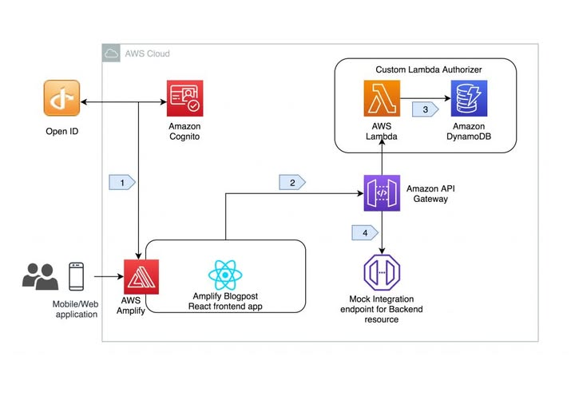

# Exploring aws amplify: Why is it a great choice for personal projects or students assignments?

Whenever you work on a student assignment or build a personal project, you have probably experienced this scenario: finishing the user interface (Frontend) very quickly, only to spend a massive amount of time building the Backend, configuring the Database, integrating Sign-up/Sign-in flows, and deploying to a server.

To solve the challenge of complex infrastructure setup and help you focus entirely on application logic, AWS Amplify is a solution well worth considering.

1. What is AWS Amplify?

    AWS Amplify is a set of tools and services that enables developers to rapidly build full-stack Web and Mobile applications on AWS infrastructure without needing deep expertise in Cloud or DevOps management.

2. Key Features

- Authentication: Integrates Amazon Cognito with just a few CLI commands or simple configurations. It provides out-of-the-box sign-up, sign-in, password reset, and secure session management flows.

- API & Database: Flexibly initializes GraphQL APIs (AWS AppSync) or REST APIs (API Gateway combined with DynamoDB). Data operations from the Frontend are optimized and seamlessly synchronized.

- Automated Hosting & CI/CD: Connects directly to GitHub or GitLab. Every time you push new code (`git push`), the system automatically executes the Build and Deploy process.

3. Practical Experience Review

     Pros:  
-   Optimal deployment speed: Particularly well-suited for demo projects, course assignments, or MVP (Minimum Viable Product) builds.

- Serverless architecture: Eliminates the cost and effort of maintaining or managing servers.
-   Cross-platform support: Integrates seamlessly with popular frameworks such as React, Next.js, Vue, Flutter, React Native, etc.

    Cons:
    
-   As the application scales and requires deep infrastructure customization (such as custom VPC configurations or complex IAM permissions), modifying the underlying resources automatically provisioned by Amplify requires additional research and effort.

4. Summary

AWS Amplify is an effective solution that streamlines the development workflow and brings your product to the Cloud reliably while saving significant time.

[...Link...](https://www.facebook.com/groups/awsstudygroupfcj/?multi_permalinks=2298180120946947&notif_id=1791348739135855&notif_t=feedback_reaction_generic&ref=notif)