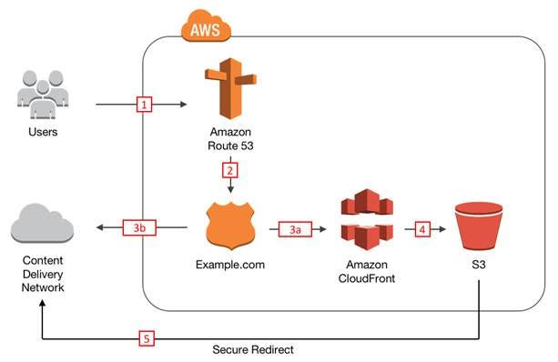

# Building a simple, secure static website with S3 + cloudfront + route 53

Once you finish building a static website (plain HTML/CSS/JS or build artifacts from React, Vue, Next.js), the next challenge is choosing a solution to store and distribute it over the internet. Common goals include optimized cost, fast access speed, secure HTTPS support, and zero server management overhead.
The trio of Amazon S3 + Amazon CloudFront + Route 53 is a standardized architecture that solves this problem cleanly and efficiently.

* Solution Architecture & Implementation Steps
  * Step 1: Store Files with Amazon S3

* Create an S3 Bucket to hold all built static web source files.

* Configure the S3 Bucket Policy and set appropriate access permissions.
* Enable Static website hosting to configure default entry documents (for example, `index.html` and `404.html`).
* Step 2: Accelerate & Secure with Amazon CloudFront (CDN)
  * Create a CloudFront Distribution and point the Origin to the newly created S3 Bucket.
  * Acceleration: Web content is cached at Edge Locations globally, minimizing latency for users.
  * Security: Integrate a free SSL/TLS certificate from AWS Certificate Manager (ACM) to enable HTTPS. At the same time, configure OAC (Origin Access Control) to block direct external access to the S3 Bucket and only allow traffic routed through CloudFront.
* Step 3: Route Custom Domains with Amazon Route 53
  * Create a Hosted Zone for your personal domain in Route 53.
  * Configure an A Record (Alias type) to point your root domain or subdomain to the CloudFront Distribution address.

Technical Value & Key Takeaways

* Cost optimization: A Serverless architecture incurs zero cost for maintaining servers (Nginx/Apache). For low traffic or personal projects, monthly costs are nearly zero.
* Scalability: CloudFront's CDN network automatically handles traffic spikes without requiring infrastructure upgrades.
* Simplified operations: No need to worry about OS patching or periodic SSL certificate renewals.
Summary

* This is one of the classic yet essential hands-on exercises that helps you master combining foundational AWS services to build a complete, secure, and industry-standard system.

[Link to the post on AWS Study Group](https://www.facebook.com/groups/awsstudygroupfcj/?multi_permalinks=2317669882331304&notif_id=1793105995816910&notif_t=feedback_reaction_generic&ref=notif)