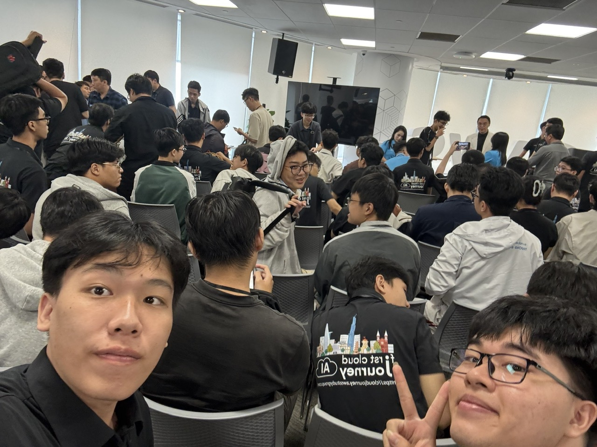
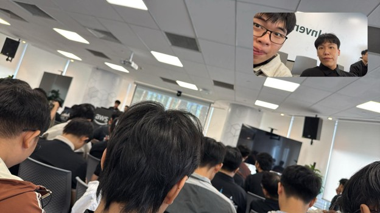

# Summary Report: “ Talkshow "The Thinking Behind Building The Bot" ”

### Event Objectives

- This talkshow offered a practical perspective on AI Agents and AI-driven applications. Rather than focusing solely on AI technology itself, the session explored how developers approach real-world problems when building AI-powered bots.   
- It also gave attendees a chance to learn from seasoned engineers and technical leaders, see how AI operates in enterprise settings, and gain clearer career insights in the tech industry. 

### Speakers

- **Thien Lu** – Program Manager, First Cloud AI Journey (FCAJ)   
- **Truong Bui** – Tech Lead, CMC Global   
- **Phong Pham** – Program Manager, First Cloud AI Journey (FCAJ)  

### Key Highlights

#### Understanding AI Agents

- The session unpacked how AI Agents go beyond traditional chatbots to handle more complex, real-world tasks. 
- Building an AI bot is more than wiring an app to a model; it requires understanding the underlying problem, user interaction patterns, and how the system processes and responds to information.

#### Real-World Programming Problems

- Discussions bridged AI concepts with everyday software engineering scenarios, showing why user needs and business goals come before technical novelty. 
- Effective AI solutions start with a well-defined problem and then identify where AI creates tangible user value.

#### The Thinking Behind Building a Bot

A standout takeaway was the structured questioning process before picking any tech stack:   
- What problem should the bot solve?   
- Who are the end users?   
- What information does the bot need?   
- What actions or capabilities should it have?   
- How should it respond across different scenarios?   
- How should the system be architected for reliability in production? 

This shifted the mindset from simply "using AI" to architecting a complete solution around a concrete problem.

#### Enterprise Perspective

Insights from CMC Global highlighted that enterprise AI systems must go beyond core functionality to address reliability, security, scalability, and measurable business value.

#### Career and Industry Insights

The closing discussion with CMC Global representatives offered practical context on career paths, interviews, and core competencies expected of engineers working on AI-enabled software.

### Key Takeaways

- Technical: AI Agents enable more capable workflows than standard chatbots; AI models must sit inside a cohesive application flow that accounts for reliability, security, scalability, and user needs.   
- Problem-Solving Mindset: Start with the problem and business requirements before choosing AWS services or AI models, and break complex problems into smaller parts to simplify design and execution.   
- Career: Building AI systems requires blending AI literacy with solid software engineering fundamentals, problem-solving, system design, and business alignment.   
### Applying to Work

- These lessons apply directly to my FCAJ project focused on an AI assistant for enterprise legal and security information. Previously, the focus leaned toward mapping out AWS services such as Amazon Bedrock, Amazon S3, AWS Lambda, API Gateway, and DynamoDB. Following the event, defining the core problem comes first.  

### Event Experience

- Learning from Speakers: Gained real-world perspectives from technical leaders and program managers experienced in delivering technology and AI initiatives.   
- Real-World AI Development: Connected academic AI concepts with practical software engineering workflows rather than treating them purely as theory.   
- Problem-Solving & Technical Thinking: Reinforced the habit of justifying technology choices against concrete requirements in the FCAJ project.   
- Career Discussion: Built a clearer view of industry expectations, encouraging stronger technical skills alongside clear project communication, problem-solving, and teamwork. 

### Core Lesson: 

A valuable AI application is defined not merely by model power, but by a clear problem, a sound workflow, reliable data, thoughtful system design, and real-world constraints—providing a stronger foundation for executing the FCAJ project ahead.

#### Some event photos

