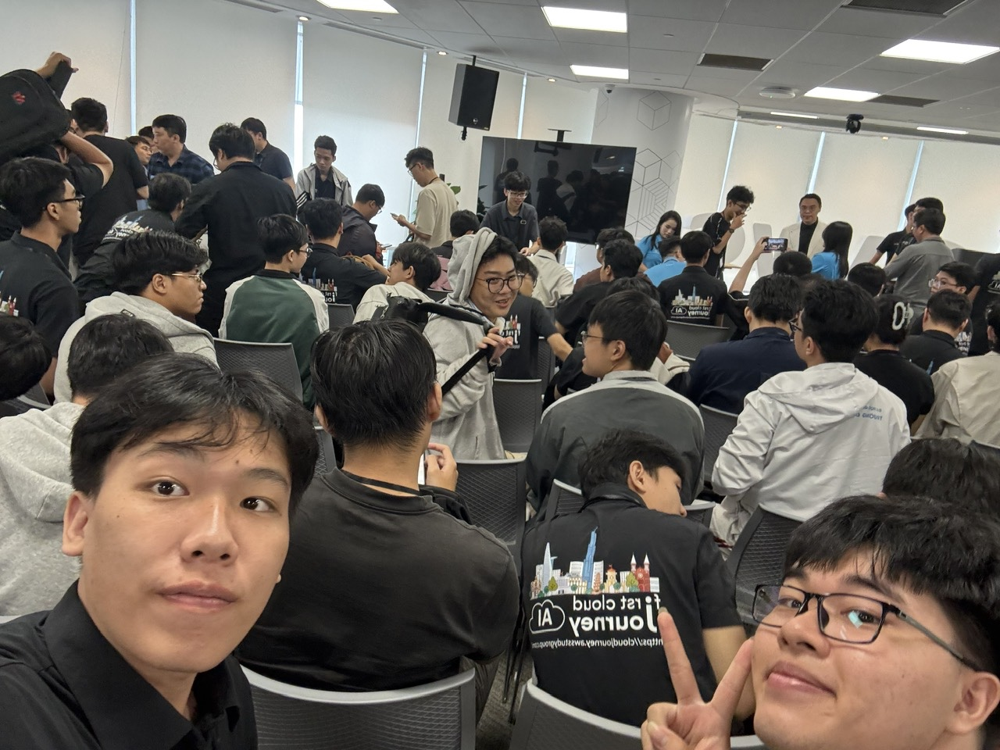
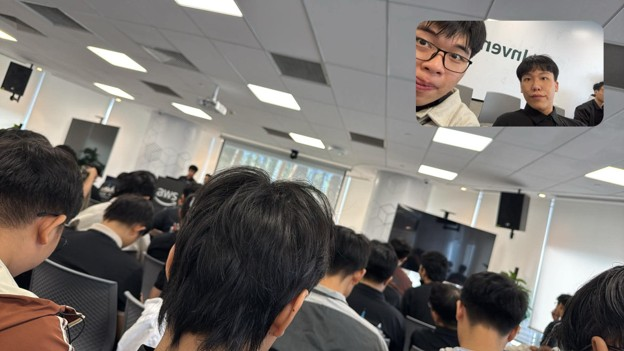

# Bài thu hoạch “ Talkshow "The Thinking Behind Building The Bot" ”

### Mục Đích Của Sự Kiện

- Buổi talkshow mang đến góc nhìn thực tế về AI Agents và các ứng dụng tích hợp AI. Thay vì chỉ đào sâu vào khía cạnh công nghệ thuần túy, chương trình tập trung vào cách lập trình viên tư duy giải quyết bài toán thực tế khi xây dựng bot AI.   

- Bên cạnh đó, đây là dịp để trao đổi cùng các kỹ sư dày dạn kinh nghiệm và lãnh đạo kỹ thuật, nắm bắt cách AI vận hành trong môi trường doanh nghiệp cũng như định hướng nghề nghiệp trong ngành công nghệ.   
### Danh Sách Diễn Giả

- **Thien Lu** – Program Manager, First Cloud AI Journey (FCAJ)   

- **Truong Bui** – Tech Lead, CMC Global   

- **Phong Pham** – Program Manager, First Cloud AI Journey (FCAJ)

### Nội Dung Nổi Bật

#### Hiểu đúng về AI Agents

- Chương trình làm rõ cách AI Agents mở rộng khả năng xử lý các tác vụ thực tế so với mô hình chatbot truyền thống. 

- Xây dựng một bot AI không chỉ dừng ở việc gọi API từ một model, đòi hỏi hiểu rõ bài toán cần giải quyết, cách người dùng tương tác và luồng xử lý - phản hồi thông tin của toàn hệ thống.

#### Bài toán lập trình gắn với thực tiễn

- Các chia sẻ kết nối lý thuyết AI với bối cảnh phát triển phần mềm thực tế, nhấn mạnh việc ưu tiên nhu cầu người dùng và mục tiêu nghiệp vụ trước khi chạy theo tính năng kỹ thuật. 

- Một giải pháp AI hiệu quả cần xuất phát từ vấn đề cụ thể rồi mới xác định giá trị mà AI mang lại.

#### Tư duy đằng sau việc xây dựng một Bot

Điểm đắt giá nhất của sự kiện nằm ở quy trình đặt câu hỏi trước khi chọn công nghệ:   

- Bot cần giải quyết vấn đề gì?   
- Ai là người sử dụng?   
- Bot cần nguồn dữ liệu nào?   
- Khả năng thực hiện của bot ra sao?   
- Bot nên phản ứng thế nào trước các tình huống khác nhau?   
- Hệ thống cần thiết kế ra sao để vận hành ổn định ngoài thực tế?   

Cách tiếp cận này giúp chuyển dịch tư duy từ "chỉ dùng AI" sang thiết kế một giải pháp hoàn chỉnh xoay quanh bài toán cốt lõi. 

#### Góc nhìn từ doanh nghiệp

- Chia sẻ từ đại diện CMC Global cho thấy hệ thống AI cấp doanh nghiệp không chỉ cần chạy đúng chức năng mà còn phải đáp ứng độ tin cậy, bảo mật, khả năng mở rộng và tạo ra giá trị kinh doanh rõ ràng.

#### Định hướng nghề nghiệp và ngành công nghệ

Phần giao lưu cuối buổi với đại diện CMC Global giúp làm rõ hơn kỳ vọng tuyển dụng, quy trình phỏng vấn và các năng lực cần trau dồi để làm việc trong mảng kỹ thuật phần mềm gắn với AI.

### Những Gì Học Được

#### Kỹ thuật:
- AI Agents xử lý được các tác vụ phức tạp hơn chatbot thông thường; cần đặt model vào một quy trình ứng dụng hoàn chỉnh và đảm bảo tính ổn định, bảo mật, khả năng mở rộng cũng như bám sát nhu cầu người dùng.

#### Tư duy giải quyết vấn đề:
- Luôn bắt đầu từ bài toán và yêu cầu nghiệp vụ trước khi chọn dịch vụ AWS hay AI model; 
- Chia nhỏ vấn đề phức tạp giúp việc thiết kế và triển khai mạch lạc hơn.

#### Nghề nghiệp

- Làm AI cần sự tổng hòa giữa kiến thức AI, nền tảng kỹ thuật phần mềm, tư duy giải quyết vấn đề, thiết kế hệ thống và khả năng nắm bắt bài toán kinh doanh.

### Ứng Dụng Vào Công Việc

Kiến thức từ buổi trò chuyện áp dụng trực tiếp vào dự án FCAJ xây dựng trợ lý AI hỗ trợ thông tin pháp lý và bảo mật cho doanh nghiệp. Trước đây, trọng tâm thường nghiêng về việc liệt kê các dịch vụ AWS như Amazon Bedrock, Amazon S3, AWS Lambda, API Gateway và DynamoDB. Sau sự kiện, bước ưu tiên hàng đầu là xác định rõ bài toán cần giải quyết.

### Trải nghiệm sự kiện & Đúc kết

- Học hỏi từ diễn giả: Tiếp thu góc nhìn thực chiến từ các leader và program manager giàu kinh nghiệm triển khai dự án công nghệ và AI.   
- Phát triển AI thực tế: Gắn kết kiến thức AI đang học với quy trình phát triển phần mềm thực tế thay vì chỉ dừng ở lý thuyết.   
- Tư duy kỹ thuật & giải quyết vấn đề: Củng cố thói quen lý giải lý do chọn công nghệ dựa trên yêu cầu thực tế của dự án FCAJ.   
- Trao đổi nghề nghiệp: Hiểu thêm kỳ vọng của doanh nghiệp công nghệ, thúc đẩy rèn luyện song song chuyên môn kỹ thuật, kỹ năng trình bày giải pháp, giải quyết vấn đề và làm việc nhóm.  

### Bài học rút ra
Một ứng dụng AI hữu ích không nằm ở việc dùng model mạnh đến đâu, mà ở bài toán rõ ràng, luồng xử lý phù hợp, dữ liệu chuẩn xác, thiết kế hệ thống tốt và bám sát yêu cầu thực tế.

#### Một số hình ảnh khi tham gia sự kiện

