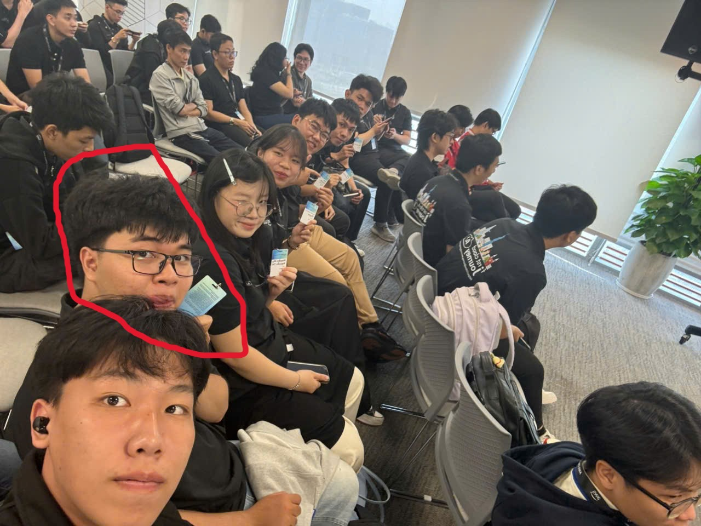
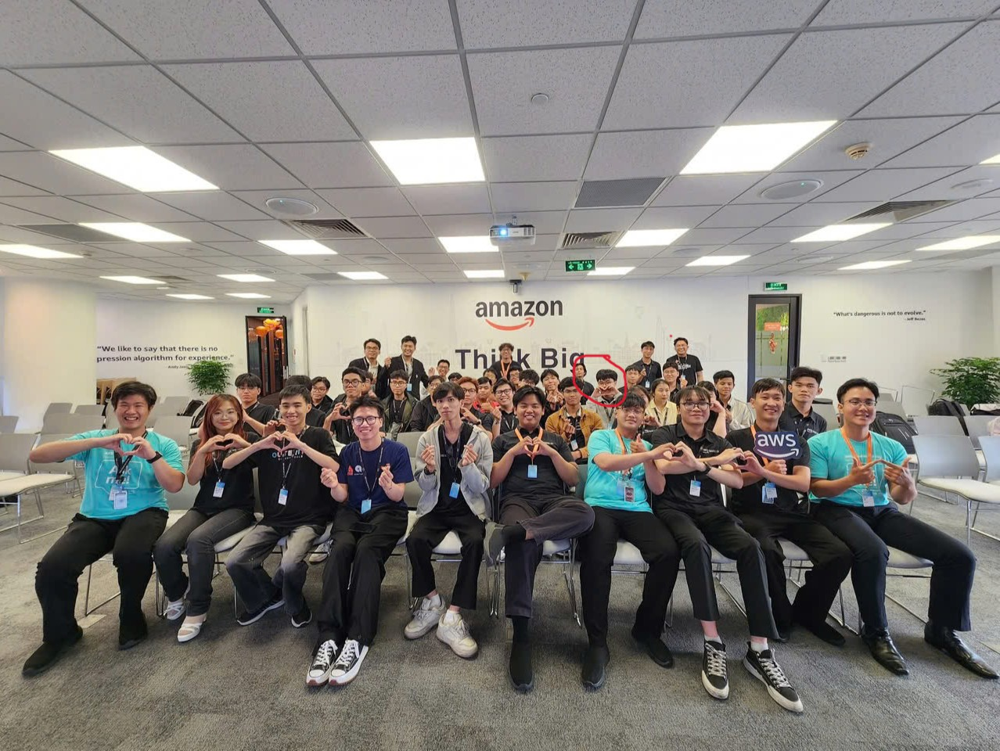

# Event Report: “AWS Cloud Day and AI Day Hanoi - Watch Party"

### Event Objectives

- AWS Cloud and AI Day Hanoi is a one-day event designed to bring AWS expertise, cloud technologies, and AI innovations directly to developers, IT professionals, business leaders, and technology enthusiasts.
- The program focuses on helping participants see how cloud computing and AI solve practical business and technical problems, centering on key topics such as Agentic AI, data analytics, cloud migration, industry solutions, and modern application development.
- The event also opens opportunities to learn directly from AWS experts, explore real-world customer experiences, and stay updated on current Cloud and AI technology trends.

### Speakers List

- **H.E. Jennifer Wicks** – U.S. Ambassador to Vietnam
- **Dr. Werner Vogels** – CTO, Amazon.com
- **Eric Yeo** – Country General Manager Malaysia, Vietnam, Indochina, AWS
- **Mai Le** – Director of Product Management, Katalon
- **Dr. Jens Lottner** – Chief Executive Officer, Techcombank

### Key Highlights

#### Agentic AI

Agentic AI is one of the highlights of the program, opening up a new development direction for AI applications. This topic helps build a broader view of how AI moves beyond simple question-and-answer interactions to participate in systems that help users complete more complex tasks.

#### Data Analytics

The event emphasizes the foundational role of data in modern cloud applications. Data is an important launchpad for AI and enterprise applications; organizations need appropriate ways to collect, process, analyze, and leverage data before effectively harnessing AI technologies.

#### Cloud Migration

The content on Cloud Migration shares how organizations move existing infrastructure and applications to the Cloud while balancing scalability, cost, reliability, and modernization. This process is not merely lifting and shifting a system from physical servers to AWS, but also a time to consider modernizing applications during migration.

#### Modern Application Development

The program introduces modern approaches to building applications on the Cloud platform. Modern applications need to aim for scalability, flexibility, availability, and resource optimization — principles that are very helpful for learning AWS and choosing the right services for a project.

#### Industry Solutions

Stories from organizations and businesses applying Cloud and AI in practice show that AWS technologies do not stop at technical experimentation, but directly solve operational problems across different industries.

### Key Takeaways

- Cloud and AI are closely connected: Cloud computing builds the foundation for AI applications in compute capacity, data storage, networking, security, and elastic infrastructure, helping businesses build and deploy AI more effectively.
- Start from the business problem: Before choosing AWS services or AI technologies, it is necessary to clarify the problem to solve, target users, required data, system goals, as well as technical and business constraints.
- Modernization goes beyond migration: Cloud migration is an opportunity to upgrade applications through managed services, serverless technologies, modern architectures, and AI when appropriate, instead of keeping the old architecture in a new environment.

### Applying to the FCAJ Project

Knowledge from AWS Cloud and AI Day Hanoi applies directly to the FCAJ project building an AI assistant for enterprise legal and security information. The event reinforces the principle of defining the business problem first before selecting AWS services.

For example, when an enterprise user enters a legal or security situation, the system will rely on the internal knowledge base to generate an appropriate response. From that requirement, a corresponding AWS architecture can be shaped:
- Amazon S3 → store internal documents and knowledge sources
- Amazon Bedrock → provide AI capabilities and foundation models
- AWS Lambda → execute application logic
- Amazon API Gateway → provide APIs for the application
- Amazon DynamoDB → store application data and conversation history

>In addition, because organizational data can be sensitive, system design needs to emphasize security, scalability, and responsible use of enterprise data.

### Event Experience

- Learning from AWS experts: Get updated on the Cloud and AI landscape directly from AWS experts and industry leaders, gaining multiple perspectives from technology and business to product development.
- Exploring current AI trends: Discussions around Agentic AI show that AI is shifting from a chatbot/Q&A tool to becoming a link in the overall application workflow.
- Understanding enterprise Cloud adoption: Practical insights from Techcombank and Katalon show that deploying Cloud and AI is also tied to business value, security, scalability, cost, and impact on existing systems.

### Most Important Lesson:
Cloud and AI technologies should be viewed as tools for solving real-world problems rather than used simply because of novelty. This helps orient the FCAJ project more practically: grasp the problem and requirements first, then design the architecture and choose suitable AWS services.

#### Some event photos

