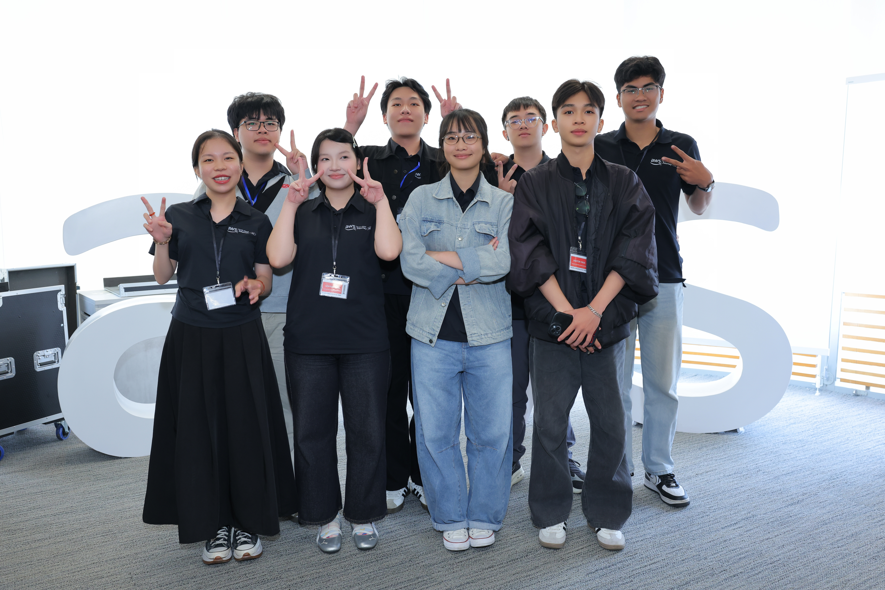
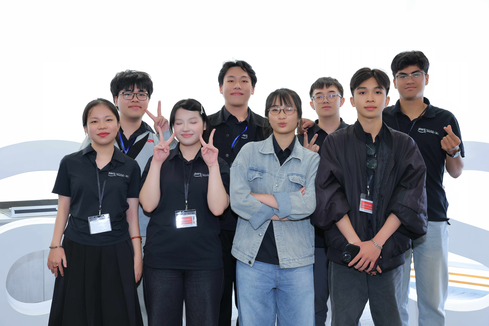
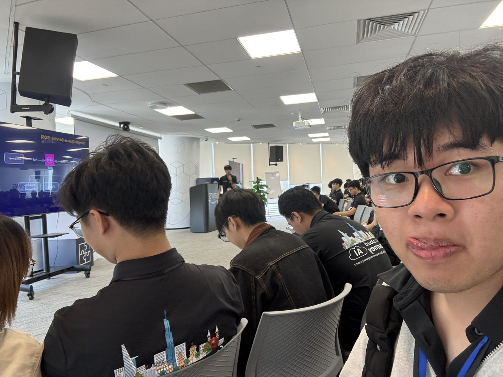
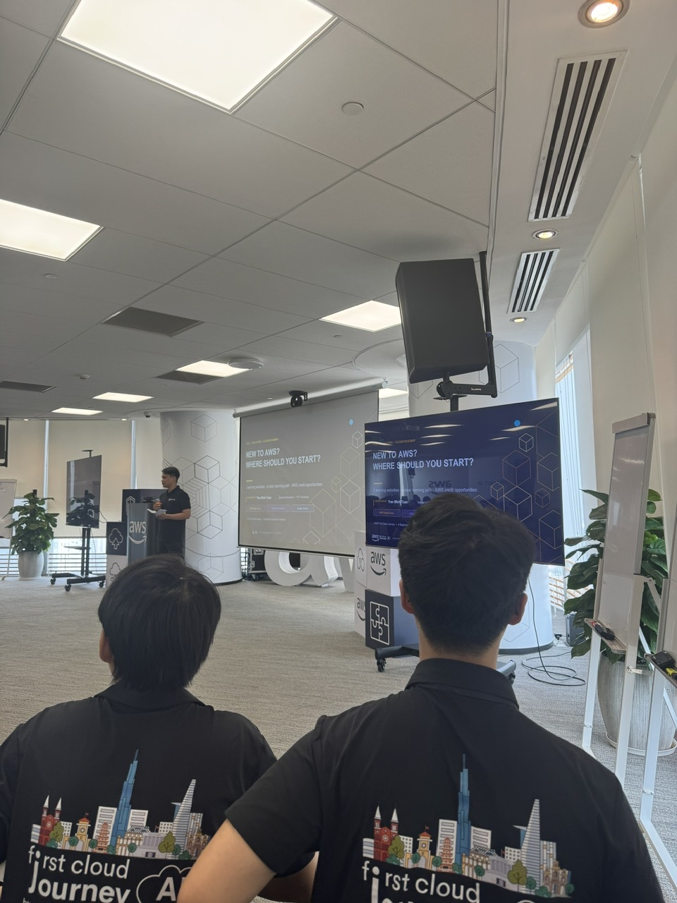

# Event Report: “AWS Cloud Architecture, Software Factories, and Career Growth”

### Event Objectives

- The event offered a well-rounded look at modern cloud architecture, spotlighting serverless computing and asynchronous system design.
- Moving beyond pure theory, the sessions shared practical lessons from building "software factories" at enterprise scale.
- It also gave attendees a chance to learn from seasoned practitioners on preparing for a cloud career, closing the gap between university curricula and industry expectations, and navigating technical internships alongside open-source contributions.

### Speakers List

- **Thinh Nguyen** – SYL Solution
- **Henry Duc Bui** – CloudThinker
- **Hung Tran** – NAB
- **Dao Luong** – FCAJ
- **Khang Duong** – FCAJ
- **Tuan Tran** – FCAJ

### Key Highlights

#### Building Software Factories at Scale

The program opened with practical takeaways on running "software factories." The discussion unpacked common bottlenecks teams encounter when scaling software delivery, emphasizing that operating at scale demands more than clean code—it requires standardized workflows, automation, and battle-tested practices from enterprise engineering teams.

#### Bridging the Education and Industry Gap

The education-focused session highlighted what students should prepare before stepping into the cloud workforce. It underscored that academic foundations must go hand in hand with hands-on technical skills to align university training with real business demands.

#### Rethinking Serverless with AWS Lambda

One of the standout technical deep dives explored **AWS Lambda Web Functions**, explaining how native HTTP support and 128-request multi-concurrency are reshaping serverless compute. The session demonstrated how removing adapter overhead and leveraging **Active CPU Billing** maximize cost efficiency, backed by live performance benchmarks comparing Serverless against Docker workloads on EC2 and ECS.

#### Building Asynchronous Systems with Amazon SQS

The **Amazon SQS** session tied architectural theory to practical system design, illustrating why modern applications lean on asynchronous processing to decouple services and scale smoothly. Speakers shared concrete design patterns and actionable tips for integrating SQS in production workloads.

#### Career Growth: Internships and Open Source

The second half of the event centered on career progression. Hearing firsthand about a 3-month AWS internship—and how cloud services were applied to real projects—provided practical guidance. In addition, the open-source session walked through making a first contribution from scratch, building a consistent habit, and using open-source work to accelerate technical growth.

### Key Takeaways

- **Technical Perspective:** Serverless architecture is advancing rapidly, with AWS Lambda features like multi-concurrency and Active CPU Billing delivering major gains in performance and cost efficiency. Meanwhile, scalable cloud systems depend on decoupled designs powered by tools like Amazon SQS, and building at scale relies on standardized "software factory" practices rather than isolated coding.
- **System Design Mindset:** The core architectural takeaway was choosing the right compute and messaging model up front. Before deploying an API or background job, developers should decide whether a workload belongs in a synchronous path (optimized Lambda functions) or an asynchronous flow (decoupled via SQS queues) to prevent bottlenecks and maintain reliability.
- **Career Perspective:** Breaking into the cloud industry takes proactive preparation. While technical proficiency is essential, hands-on experience—built through internships, practical AWS projects, and steady open-source contributions—is what sets candidates apart.

### Applying to the FCAJ Project

Insights from this event translate directly into my FCAJ project, where I am developing an **AWS Serverless Legal RAG Assistant**.

Prior to attending, I had already provisioned the core stack using **Amazon Bedrock Knowledge Bases**, **API Gateway**, **DynamoDB**, and a **React** frontend hosted on **S3**. However, the Lambda and SQS sessions sparked concrete ideas to refine the architecture:

- **Applying AWS Lambda Optimizations:** My `legal-ai-chat-lambda` function currently processes incoming requests from API Gateway. Understanding multi-concurrency and Active CPU Billing helps me tune execution times and keep costs predictable when multiple users query the assistant concurrently.
- **Applying Amazon SQS for Document Processing:** Currently, legal documents land in my `fcaj-raw-docs` S3 bucket before being chunked. The SQS session inspired decoupling this ingestion pipeline by placing an **Amazon SQS** queue between S3 and the processing service. Handling document ingestion asynchronously ensures the system can absorb large batches of legal files gracefully without throttling or failing.

> This event shifted my focus from simply "getting the API to work" to "architecting a resilient, decoupled, and cost-effective serverless system."

### Event Experience

- **Learning from Experienced Speakers:** Hearing directly from engineers who have built large-scale production systems clarified how services like Lambda and SQS are applied in enterprise settings beyond introductory tutorials.
- **Understanding Real-World Architecture:** Rather than merely listing service features, live benchmarks and design patterns demonstrated why specific architectural choices are made to solve scalability and cost challenges in production.
- **Career Motivation:** The internship and open-source talks motivated me to look beyond my FCAJ project, start building a public contribution portfolio, and strengthen my collaboration skills for industry work.

### Most Important Lesson

Building dependable cloud software requires pairing efficient compute (**Lambda**) with resilient messaging (**SQS**). A well-rounded cloud engineer must master not only technical implementation, but also a continuous learning habit grounded in real-world projects and open-source collaboration. This mindset will guide me as I refine my Legal RAG Assistant and grow my career.

#### Some event photos
 
 
 
