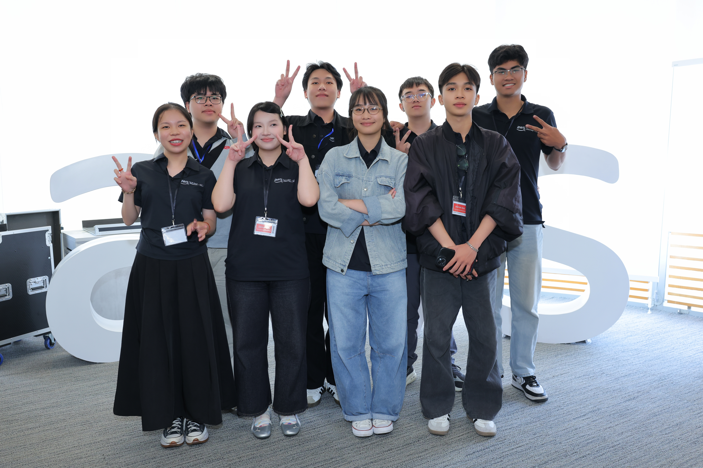
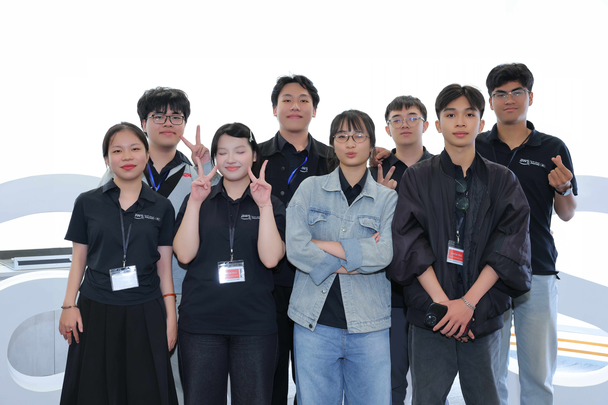
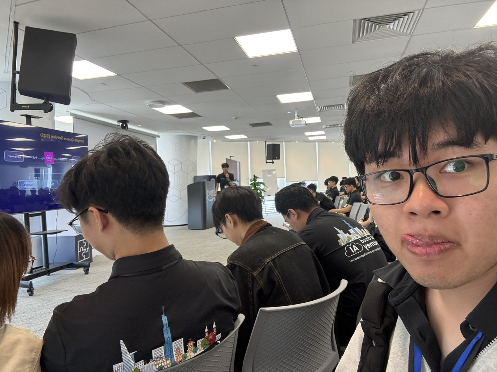
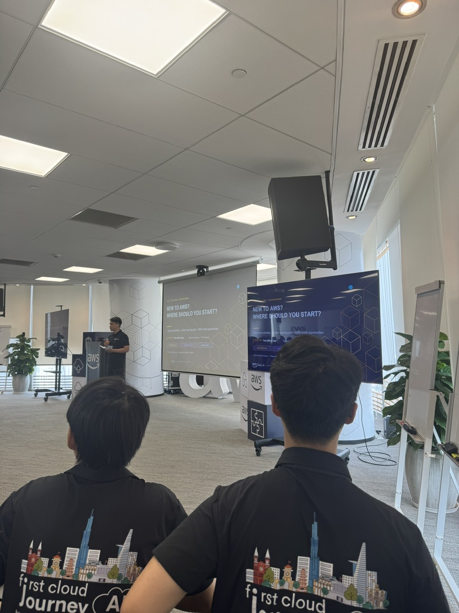

# Bài thu hoạch: “AWS Cloud Architecture, Software Factories, and Career Growth”

### Mục Đích Của Sự Kiện

- Sự kiện mang đến bức tranh toàn diện về kiến trúc Cloud hiện đại, tập trung vào điện toán Serverless và các hệ thống xử lý bất đồng bộ.
- Thay vì chỉ dừng ở lý thuyết thuần túy, các phiên chia sẻ đi sâu vào kinh nghiệm thực chiến khi xây dựng mô hình "software factory" ở quy mô lớn.
- Đây cũng là dịp giao lưu trực tiếp với các chuyên gia trong ngành để nắm bắt cách chuẩn bị hành trang nghề nghiệp Cloud, thu hẹp khoảng cách giữa giảng đường và doanh nghiệp, cũng như định hướng thực tập kỹ thuật và đóng góp mã nguồn mở (open-source).

### Danh Sách Diễn Giả

- **Thinh Nguyen** – SYL Solution
- **Henry Duc Bui** – CloudThinker
- **Hung Tran** – NAB
- **Dao Luong** – FCAJ
- **Khang Duong** – FCAJ
- **Tuan Tran** – FCAJ

### Nội Dung Nổi Bật

#### Xây Dựng "Software Factory" Ở Quy Mô Lớn

Mở đầu chương trình là những bài học thực tế xoay quanh việc vận hành "software factory". Phần thảo luận làm rõ các rào cản phổ biến khi mở rộng quy mô phát triển phần mềm, nhấn mạnh rằng để đi đường dài ở quy mô lớn, đội ngũ không chỉ cần code tốt mà còn phải có quy trình chuẩn hóa, tự động hóa và kinh nghiệm triển khai thực tế trong môi trường doanh nghiệp.

#### Thu Hẹp Khoảng Cách Giữa Giảng Đường Và Doanh Nghiệp

Phiên chia sẻ về định hướng đào tạo chỉ ra những yếu tố sinh viên cần chuẩn bị trước khi bước chân vào ngành Cloud. Kiến thức nền tảng trên trường cần được kết hợp chặt chẽ với kỹ năng thực hành thực tế để đáp ứng đúng kỳ vọng và bài toán vận hành của doanh nghiệp.

#### Góc Nhìn Mới Về Serverless Với AWS Lambda

Phần phân tích chuyên sâu về **AWS Lambda Web Functions** mang đến nhiều góc nhìn kỹ thuật giá trị, giải thích cách hỗ trợ HTTP gốc (native HTTP) và khả năng xử lý đồng thời 128 request (multi-concurrency) đang định hình lại điện toán Serverless. Việc loại bỏ tầng adapter trung gian kết hợp cơ chế **Active CPU Billing** giúp tối ưu chi phí đáng kể, được minh chứng qua các bài đo hiệu năng trực tiếp (live benchmarks) so sánh giữa Serverless và Docker chạy trên EC2/ECS.

#### Xây Dựng Hệ Thống Bất Đồng Bộ Với Amazon SQS

Chủ đề về **Amazon SQS** gắn kết lý thuyết kiến trúc với thiết kế hệ thống thực tế, giải thích lý do các ứng dụng hiện đại ưu tiên xử lý bất đồng bộ để tách rời các dịch vụ (decoupling) và mở rộng linh hoạt. Diễn giả cũng cung cấp các mẫu thiết kế (design patterns) cụ thể cùng kinh nghiệm áp dụng SQS vào bài toán thực tiễn.

#### Phát Triển Sự Nghiệp: Thực Tập Và Mã Nguồn Mở

Nửa sau sự kiện tập trung vào lộ trình phát triển cá nhân. Câu chuyện thực tế từ hành trình thực tập AWS kéo dài 3 tháng — cụ thể là cách đưa dịch vụ AWS vào dự án thật — mang lại nhiều lời khuyên thiết thực. Bên cạnh đó, phiên hướng dẫn đóng góp open-source cũng chia sẻ chi tiết cách tạo đóng góp đầu tiên từ con số 0, duy trì thói quen đều đặn và tận dụng điều này để bứt phá kỹ năng lẫn sự nghiệp.

### Những Gì Học Được

- **Góc nhìn kỹ thuật:** Kiến trúc Serverless đang phát triển rất nhanh; các tính năng như multi-concurrency và Active CPU Billing trên AWS Lambda cải thiện rõ rệt cả hiệu năng lẫn chi phí. Bên cạnh đó, ứng dụng Cloud hiện đại cần kiến trúc tách rời với sự hỗ trợ của công cụ hàng đợi như Amazon SQS, đồng thời việc phát triển phần mềm quy mô lớn đòi hỏi quy trình chuẩn hóa ("software factory") thay vì chỉ viết code rời rạc.
- **Tư duy thiết kế hệ thống:** Bài học lớn nhất từ các phiên kiến trúc là lựa chọn đúng mô hình tính toán và truyền tin. Trước khi triển khai một API hay tác vụ xử lý, lập trình viên cần cân nhắc tác vụ đó nên chạy đồng bộ (dùng Lambda tối ưu) hay bất đồng bộ (tách luồng qua hàng đợi SQS) để tránh nghẽn cổ chai và đảm bảo độ tin cậy hệ thống.
- **Góc nhìn nghề nghiệp:** Gia nhập ngành Cloud đòi hỏi sự chuẩn bị chủ động. Kỹ năng kỹ thuật là nền tảng bắt buộc, nhưng trải nghiệm thực tế thông qua thực tập, ứng dụng AWS vào dự án thật và duy trì đóng góp cho cộng đồng mã nguồn mở mới là điểm tạo nên sự khác biệt cho ứng viên.

### Ứng Dụng Vào Dự Án FCAJ

Những kiến thức từ sự kiện có thể áp dụng trực tiếp ngay vào dự án FCAJ của mình — xây dựng trợ lý AI pháp lý theo kiến trúc AWS Serverless (**AWS Serverless Legal RAG Assistant**).

Trước khi tham gia buổi chia sẻ, mình đã dựng xong hạ tầng cốt lõi gồm **Amazon Bedrock Knowledge Bases**, **API Gateway**, **DynamoDB** và giao diện **React** host trên **S3**. Tuy nhiên, các phiên thảo luận về AWS Lambda và Amazon SQS đã mở ra hướng tối ưu mới cho kiến trúc hiện tại:

- **Tối ưu hóa AWS Lambda:** Function `legal-ai-chat-lambda` hiện tại đảm nhận xử lý request từ API Gateway. Kiến thức về multi-concurrency và Active CPU Billing giúp mình biết cách tinh chỉnh thời gian thực thi và kiểm soát chi phí hiệu quả hơn khi nhiều người dùng truy vấn trợ lý pháp lý cùng lúc.
- **Ứng dụng Amazon SQS cho luồng xử lý tài liệu:** Hiện tại, tài liệu pháp lý được lưu trong bucket S3 `fcaj-raw-docs` trước khi chia nhỏ (chunking). Phiên chia sẻ về SQS gợi ý hướng tách rời luồng dữ liệu này bằng cách đặt một hàng đợi **Amazon SQS** giữa S3 và dịch vụ xử lý để tiếp nhận tài liệu bất đồng bộ. Nhờ đó, nếu hệ thống nhận lượng lớn văn bản pháp luật cùng lúc, kiến trúc vẫn mở rộng mượt mà mà không bị nghẽn (throttling) hay sập dịch vụ.

> Sự kiện giúp mình chuyển dịch tư duy từ việc chỉ tập trung "làm cho API chạy được" sang "thiết kế một kiến trúc Serverless có khả năng mở rộng cao, tách rời linh hoạt và tối ưu chi phí".

### Trải Nghiệm Trong Event

- **Học hỏi từ các diễn giả giàu kinh nghiệm:** Tiếp cận góc nhìn thực tế từ những kỹ sư đã trực tiếp xây dựng các hệ thống lớn, giúp hiểu rõ cách các dịch vụ như Lambda và SQS vận hành trong môi trường doanh nghiệp ngoài phạm vi các bài hướng dẫn cơ bản.
- **Hiểu kiến trúc trong môi trường thực tế:** Thay vì chỉ nắm chức năng từng dịch vụ, các bài benchmark trực tiếp và mẫu thiết kế kiến trúc giúp lý giải rõ tại sao và khi nào nên chọn công nghệ đó để giải bài toán mở rộng và chi phí trên production.
- **Động lực phát triển nghề nghiệp:** Những chia sẻ về kỳ thực tập và đóng góp open-source tạo thêm động lực để mình không chỉ tập trung vào dự án FCAJ mà còn bắt đầu xây dựng hồ sơ đóng góp công khai, rèn luyện khả năng cộng tác trong môi trường công nghệ.

### Bài Học Quan Trọng Nhất

Xây dựng phần mềm Cloud vững chắc đòi hỏi sự cân bằng giữa năng lực xử lý tối ưu (**Lambda**) và cơ chế giao tiếp tin cậy (**SQS**). Một kỹ sư Cloud giỏi không chỉ làm chủ mặt triển khai kỹ thuật của từng dịch vụ mà còn cần duy trì thói quen học hỏi liên tục qua dự án thực tế và cộng đồng mã nguồn mở. Tư duy toàn diện này sẽ là định hướng để mình tiếp tục hoàn thiện trợ lý AI pháp lý cũng như phát triển sự nghiệp sau này.

#### Một số hình ảnh tại sự kiện
 
 
 
