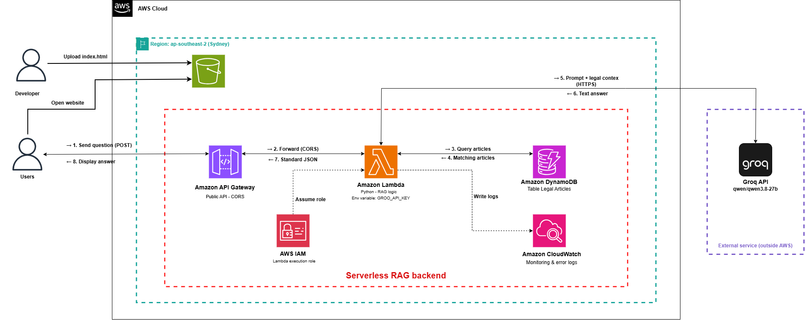

#### Concepts
- **RAG (Retrieval-Augmented Generation):** retrieves relevant passages first (Retrieval), injects them into the prompt (Augmentation), and lets the model answer based strictly on those passages (Generation).
- **Knowledge Base on DynamoDB:** legal articles are stored as items in a DynamoDB table and queried by keywords. This approach is simple and fits within the AWS Free Tier, though it does not capture semantics like vector search.
- **Serverless:** Lambda, API Gateway, and DynamoDB scale automatically and bill by usage, making them suitable for low-budget projects.
- **Groq API:** an external inference service running a language model (`qwen/qwen3.8-27b`), called by Lambda over HTTPS.

#### Problem and Objectives
Employees need quick answers regarding personal data regulations (for example, using customer citizen ID / CCCD data to send marketing messages). Public chatbots may fabricate legal articles or citations. Objective: answers stay strictly grounded in the legal texts provided by the team, running on AWS at nearly zero cost.

#### Architecture Diagram & Data Flow
##### Architecture and Data Flow
Data flow:
1. Users open the website on S3, type a question into the chat box, and submit. `index.html` sends an HTTP POST over HTTPS to API Gateway.
2. API Gateway checks CORS and forwards the payload to the Lambda function.
3. Lambda queries the `LegalArticles` DynamoDB table to find legal articles relevant to the question (`retrieve_legal_context` function).
4. DynamoDB returns matching legal articles to Lambda as legal context.
5. Lambda assembles the complete prompt (system prompt + legal context + question) and calls the Groq API.
6. Groq returns the answer text to Lambda.
7. Lambda formats a standard JSON response (including error codes if any) and returns it to API Gateway.
8. API Gateway returns the result and the chat box displays it. Lambda logs are written to Amazon CloudWatch throughout the process.

##### Components
| Component | AWS Service / Resource |
| --- | --- |
| Prompt & RAG logic | Lambda (Python) |
| Knowledge Base | DynamoDB – `LegalArticles` |
| Backend API | API Gateway + Lambda |
| Frontend | S3 static website – `index.html` |
| Security & Operations | CloudWatch, Budgets, IAM |

##### Implemented vs. Planned
The system differs from the initial design in several areas. This table helps the workshop accurately reflect what is currently in place.

| Item | Initial Design | Currently Implemented |
| --- | --- | --- |
| Knowledge Base | S3 + Bedrock Knowledge Bases | DynamoDB `LegalArticles` table (keyword lookup) |
| LLM | Amazon Bedrock | Groq API (outside AWS) |
| Frontend | AWS Amplify | S3 static website |
| Authentication | Cognito | Not yet implemented (public API) |
| Response Format | Structured: risk level, articles, evidence... | Text answer wrapped in JSON |
| Conversation History | DynamoDB | Not yet implemented |
| Incident Reporting + Alerts | SNS | Future direction |

#### AI Safety Principles
- Preliminary assessment only, not an official legal conclusion.
- Answer based strictly on the provided legal articles; do not fabricate articles or citations.
- No basis in the database → state clearly.

