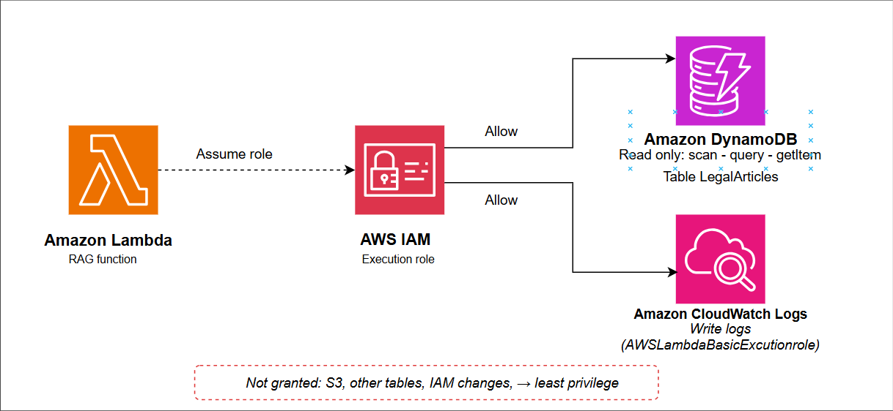
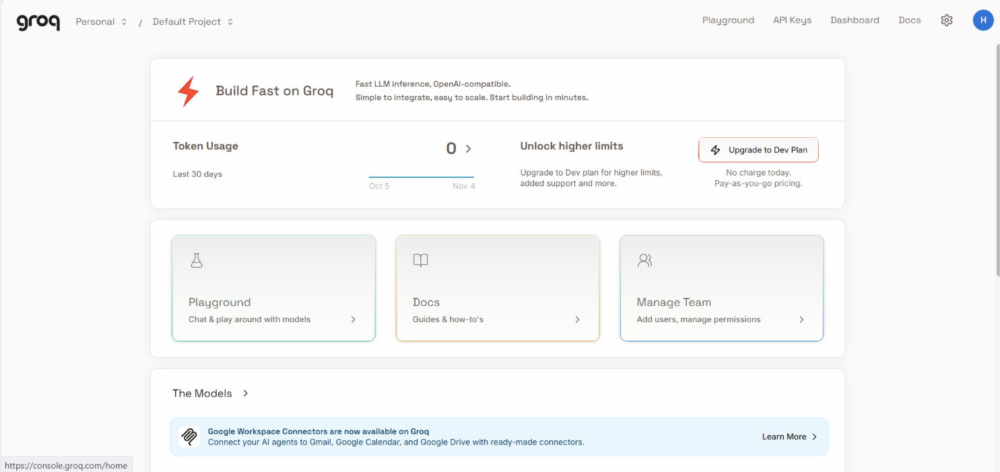
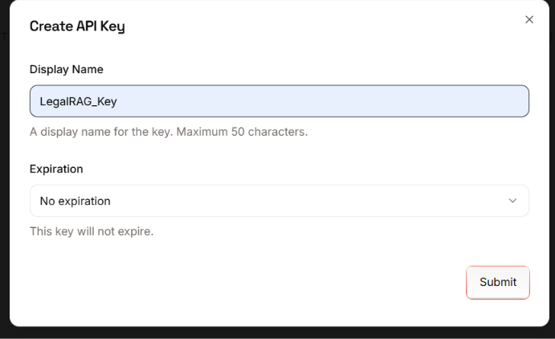
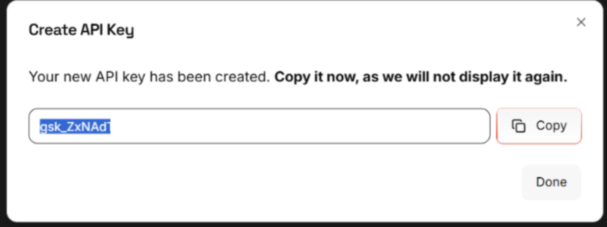
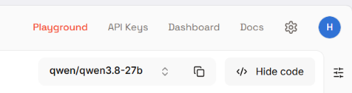
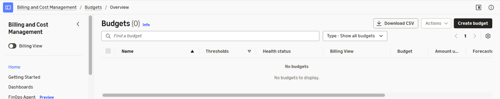
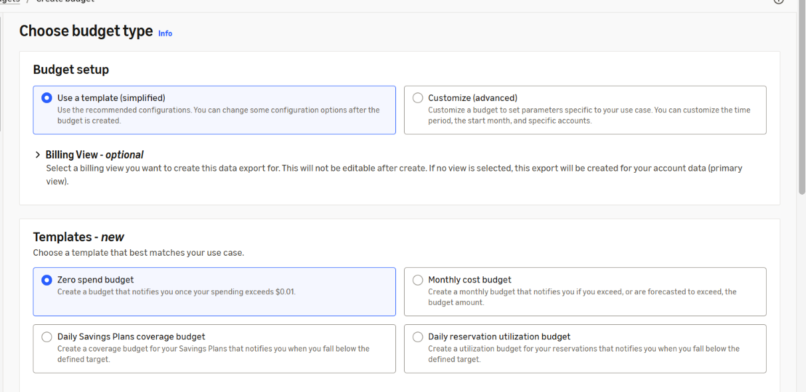
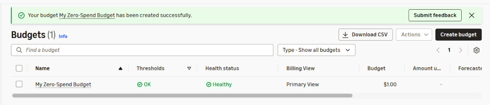

### AWS Account and Region

All resources are created within a single region: `ap-southeast-2` (Asia Pacific – Sydney), matching the website URL. Enable MFA for the root account and work via an IAM user rather than using root.

### IAM Role for Lambda

Lambda only needs two permissions: reading the `LegalArticles` table and writing logs. Replace the placeholders with your account ID and region.

```json
{
  "Version": "2012-10-17",
  "Statement": [
    {
      "Sid": "ReadLegalArticles",
      "Effect": "Allow",
      "Action": [
        "dynamodb:Scan",
        "dynamodb:Query",
        "dynamodb:GetItem"
      ],
      "Resource": "arn:aws:dynamodb:ap-southeast-2:<ACCOUNT_ID>:table/LegalArticles"
    },
    {
      "Sid": "CreateLogGroup",
      "Effect": "Allow",
      "Action": "logs:CreateLogGroup",
      "Resource": "arn:aws:logs:ap-southeast-2:<ACCOUNT_ID>:*"
    },
    {
      "Sid": "WriteLogs",
      "Effect": "Allow",
      "Action": [
        "logs:CreateLogStream",
        "logs:PutLogEvents"
      ],
      "Resource": "arn:aws:logs:ap-southeast-2:<ACCOUNT_ID>:log-group:/aws/lambda/legal-ai-chat-lambda:*"
    }
  ]
}
```

Also attach the managed policy `AWSLambdaBasicExecutionRole` so Lambda can write logs to CloudWatch.



### Groq Account and API Key

Create an API Key on Groq and select the model in Playground.

#### Creating an Account and Accessing Groq Console
1. Go to `console.groq.com` and sign in (or sign up for a new account).
2. Once signed in, you will see the Groq Console Dashboard.



#### Groq Dashboard Overview
- View **Token Usage** over the last 30 days.
- Shortcuts for **Playground**, **Docs**, and **Manage Team** help test-chat with models, view documentation, and manage members.
- In the top-right menu bar, select **API Keys** to go to the key management page.

#### Creating an API Key
1. On the **API Keys** page, you will see the project's key list. Since no keys have been created yet, the table displays `(No keys)`.
2. Select **Create API Key** on the right.
3. In the **Create API Key** dialog:
   - **Display Name**: enter a memorable name for the key (up to 50 characters).
   - **Expiration**: choose the expiration period for the key.
4. Select **Submit**.



5. The system displays the newly created API key in the format `gsk…..`:
 
   - Select **Copy** to copy the key.
   - Note: the key is shown only once. Save it immediately in a safe place, as it cannot be viewed again after closing the window.
   - Select **Done** to finish.

#### Selecting a Model in Playground


1. On the menu bar, select **Playground**.
2. In the model selector box at the top, choose the model to use. In this workshop, it is `qwen/qwen3.8-27b`.
3. Select **View code** (displays **Hide code** when open) to view sample API call code for the selected model.

### Resource Inventory

| Resource | Name | Notes |
| --- | --- | --- |
| S3 bucket | `ai-legal-assistant-frontend-hau` | Static website hosting |
| DynamoDB | `LegalArticles` | Knowledge base |
| Lambda | Lambda function: `legal-ai-chat-lambda` | Python |
| API Gateway | API: `LegalChatAPI` | Public endpoint called by the website |

### Cost Alerts

Create an AWS Budget with email alerts before building anything. The project goal is `$0` within the Free Tier; alerts help detect anomalies early.

#### Opening the Budgets Page
1. In the AWS Management Console, type `Billing and Cost Management` into the search bar and press **Enter**.
2. In the left navigation menu, select **Budgets**.

#### Empty Budgets Page


- The table displays `No budgets`, meaning the account does not have any cost alerts yet.
- Select **Create budget** on the right.

#### Choosing Budget Type
1. On the **Choose budget type** page:
   - **Budget setup**: select **Use a template (simplified)** (uses recommended preset configurations). The **Customize (advanced)** option allows more granular settings but is not needed here.
   

   - **Templates**: select **Zero spend budget**, which notifies you as soon as spending exceeds `$0.01`. Other templates (**Monthly cost budget**, **Savings Plans**, **Reservation**) do not fit the `$0` goal.
   - **Billing View** is optional; skip it.
   - Scroll to the bottom of the page and select **Next**.

#### Naming and Alert Email Recipients
1. On the **Zero spend budget - Template** page:
   - **Budget name**: keep the default name `My Zero-Spend Budget` or enter a more descriptive name, such as `LegalRAG-Zero-Spend`.
   - **Email recipients**: enter email addresses to receive alerts, separated by commas (up to 10). If a red prompt shows `Enter a valid email address` because the field is blank, enter a real email address to clear the error.
   - **Scope**: `All AWS services`, applying to all services in the account.
   - The system clearly notes that you will receive an email whenever any charge exceeds `$0.01`.
   - Keep template settings at default (can be adjusted later).
   - Select **Create budget**.
   
   
2. Budget created successfully and in **Healthy** status:
   - The notification `Your budget My Zero-Spend Budget has been created successfully` appears.
   - The **Budgets (1)** list shows the new budget with **Thresholds: OK** and **Health status: Healthy**, meaning no costs have exceeded the threshold yet.
   - The **Budget** column shows `$1.00`, which is the template baseline (the alert threshold remains `$0.01`).

### Legal Reference Materials

Source: **Decree 13/2023/ND-CP**. Before demoing, verify which provisions are currently in effect and whether any new laws amend or partially replace the decree.