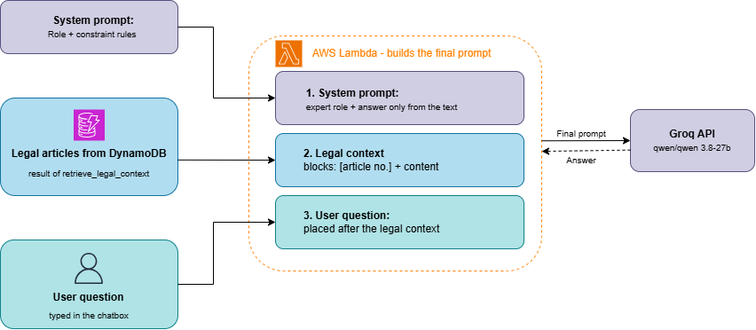

### Overview

| Item | Details |
| --- | --- |
| **Purpose** | Shape how the language model receives and processes legal data before writing code. |
| **AWS Services** | None (designed; tested in Groq playground) |
| **Outputs** | System prompt and prompt template used in Lambda |

### 5.3.1 Building Role-Oriented System Prompt

**Objective**
Force the model to act as a legal advisory specialist on regulations in Vietnam, such as Decree 13/2023/ND-CP.

**Steps**
1. Write a role definition statement (Vietnamese personal data law specialist).
2. Require answers in Vietnamese and state the legal articles used.
3. Add a disclaimer: preliminary answer, not official legal advice.

**Verification**
The model responds in the expected role and tone.

### 5.3.2 Setting Context Constraints

**Objective**
Force the model to answer based strictly on legal texts retrieved from the database.

**Steps**
1. Add strict rules: answer only based on the provided legal texts; do not fabricate or extrapolate outside the context.
2. Add a fallback mechanism: if the provided texts are insufficient, clearly state that there is not enough legal basis.
3. Test with out-of-scope questions (for example, questions about taxes).

**Verification**
Out-of-scope questions receive a "not enough legal basis" response instead of a fabricated answer.

### 5.3.3 Defining Input Data Structure

**Objective**
Decide how Lambda injects DynamoDB data into the outgoing prompt.

**Steps**
1. Format each retrieved legal article into a labeled block (article number + content).
2. Place the legal context before the user's question in the message.
3. Limit the number and length of legal articles so they stay within the model's rate and token limits.

**Verification**
The printed prompt contains all three parts in the right order.