### Overview

| Item | Details |
| --- | --- |
| **Purpose** | Serverless backend that retrieves legal articles, calls the LLM, and provides a stable API. |
| **AWS Services** | DynamoDB, Lambda, API Gateway, CloudWatch |
| **Inputs** | HTTP POST containing the user's question |
| **Outputs** | Standard JSON containing the answer or an error code |
| **Dependencies** | Prompt from Phase 1; Groq API key |

### 5.4.1 Building the Knowledge Base on DynamoDB

**Objective**
Store legal articles in a table that Lambda can query.

**Steps**

1. **Create the `LegalArticles` DynamoDB table**
   - In the AWS Management Console, type `DynamoDB` in the search bar and press **Enter**.
   - In the left menu, select **Tables**, then select **Create table**.
    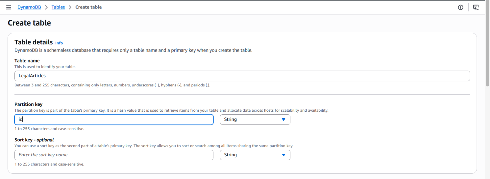

   - **Table details**:
     - **Table name**: name the table `LegalArticles`. Length is 3–255 characters, containing only letters, numbers, underscores (`_`), hyphens (`-`), and periods (`.`).
     - **Partition key**: enter `id`, type `String`. This is the primary key used to identify each legal article. DynamoDB hashes this value to determine where to store and find items.
     - **Sort key** (optional): leave blank since the table only needs a single key, `id`.
   - Keep default settings and select **Create table**. 
   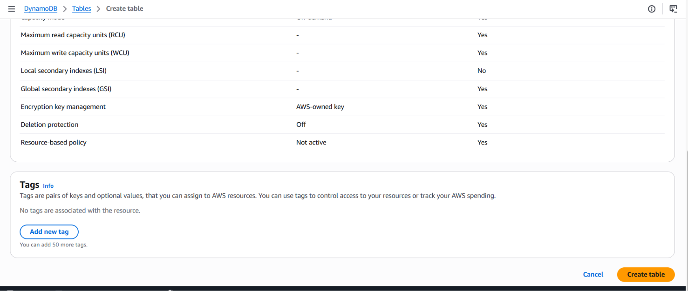

   After a few seconds, the `LegalArticles` table transitions to **Active**. Subsequent steps add articles from Decree 13/2023/ND-CP into this table.

2. **Prepare the IAM Role for Lambda**
   - In the AWS Management Console, type `IAM` in the search bar and press **Enter**.
   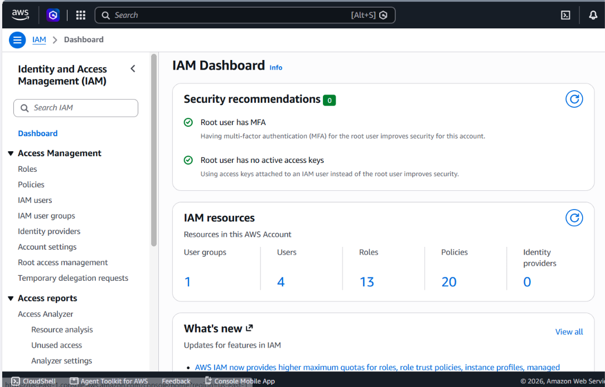

   - On the **IAM Dashboard**:
     - **Security recommendations** shows the account meets two security recommendations: MFA is enabled on the root user, and the root user has no active access keys. This follows best practice: enable MFA on root and work via an IAM user.
     - **IAM resources** summarizes existing resources: 1 user group, 4 users, 13 roles, 20 policies, and 0 identity providers.
     - The left menu includes **Roles**, **Policies**, **IAM users**, etc. We will use **Roles** to create a role for Lambda.
   - In the left menu, select **Roles**.
   - The **Roles** list page displays the account's roles (13). A role is an identity with specific permissions and short-term credentials that trusted entities (such as Lambda) can assume.
   - Select **Create role** on the right to create a new role.
   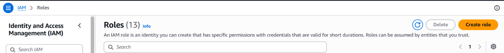
   - When creating the role, configure as follows:
     - **Trusted entity type**: select `AWS service`, **Use case**: select `Lambda`.
     - **Permissions**: attach the managed policy `AWSLambdaBasicExecutionRole` so Lambda can write logs to CloudWatch, and add a policy allowing read access to the `LegalArticles` table (granting only least-privilege permissions needed).
     - **Role name**: enter a descriptive name, for example `legal-ai-chat-role`.
   - Select **Create role**.
   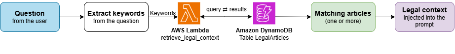

*(Retrieving articles from DynamoDB – `retrieve_legal_context`)*
    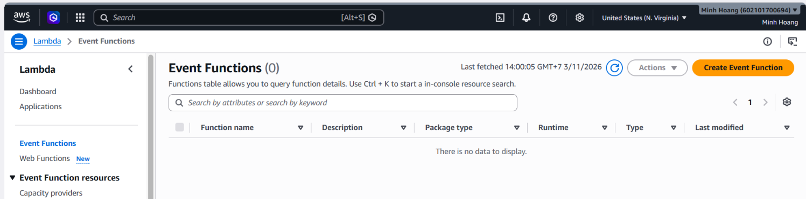

### 5.4.2 Programming the AWS Lambda Function (RAG Logic & Groq API)

**Objective**
Retrieve legal context and generate answers within a single Python function.

**Steps**

1. **Create the Lambda function**
   - In the AWS Management Console, type `Lambda` in the search bar and press **Enter**.
   - The **Functions** page lists Lambda functions in the current region. Select **Create function** on the right to create a new function.
   - On the **Create function** page, select **Author from scratch**:
    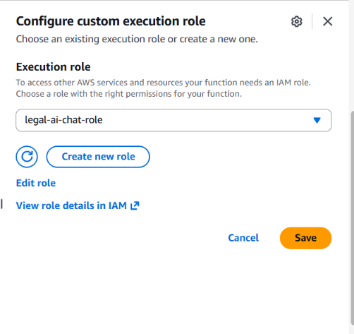
    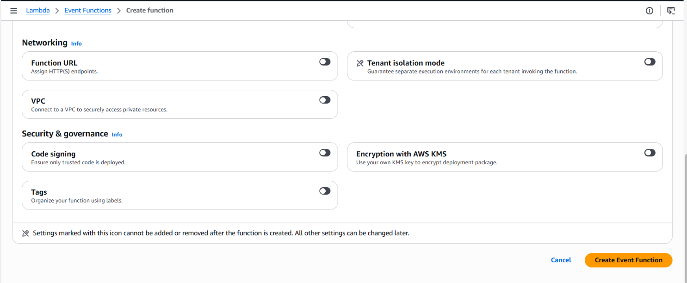 

     - **Function name**: name it `legal-ai-chat-lambda`. Length is 1–64 characters, no spaces, containing only letters, numbers, hyphens (`-`), and underscores (`_`).
     - **Runtime**: select `Python 3.12` (the language for writing the function; the console editor supports Node.js, Python, and Ruby).
     - **Permissions**: by default, Lambda creates an execution role with only CloudWatch Logs write permissions. Because our function also needs to read DynamoDB, we will use an existing role in the next step.

2. **Attach the created Execution Role**
   - Scroll down to **Additional settings** and toggle on **Custom execution role**. Keep other options such as ARM64 architecture, Function URL, VPC, and Durable execution turned off.
   - When **Custom execution role** is enabled, the **Configure custom execution role** panel appears on the right. Open the **Execution role** dropdown to select an existing role:
     - **Execution role**: select `legal-ai-chat-role` (the role created in the previous step).
     - To inspect the role's permissions, select **View role details in IAM**.
     - Select **Save**.
    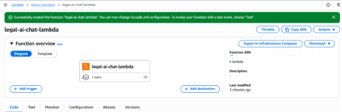
    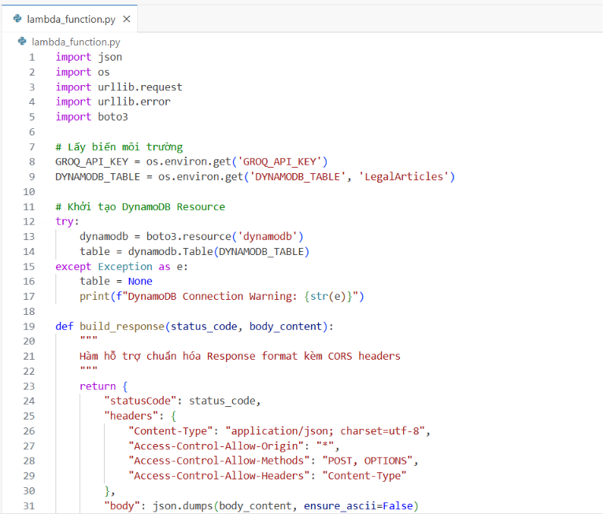

   - Check **Networking** and **Security & governance**: leave Function URL, VPC, Tenant isolation mode, Code signing, Encryption with AWS KMS, and Tags at their defaults (off). We will use API Gateway instead of a Function URL. Note: settings with special icons cannot be added or removed after function creation; remaining settings can be changed later.
   - Select **Create function**. A confirmation message indicates the function was created successfully.
   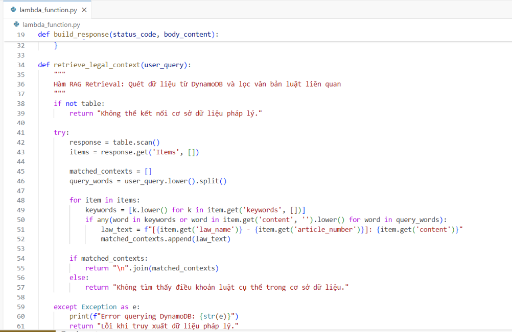

3. **Program the Lambda function (`lambda_function.py`)**
    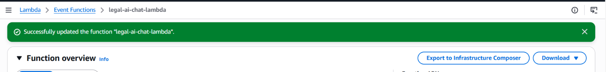
   - After pasting the code into `lambda_function.py`, select **Deploy** to save and apply the code.
   - The green banner `Successfully updated the function “legal-ai-chat-lambda”` indicates the code is updated. If you do not click **Deploy**, Lambda continues running the old code.
   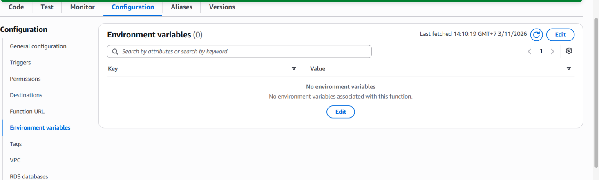
   

4. **Add the `GROQ_API_KEY` environment variable**
   - The code reads the key from the `GROQ_API_KEY` environment variable so we do not hardcode keys directly in the source code.
   - Select the **Configuration** tab, then select **Environment variables** in the left menu.
   - **Environment variables (0)** is empty → select **Edit** to add a new variable.
   - On the **Edit environment variables** page, select **Add environment variable** and enter:
     - **Key**: `GROQ_API_KEY`
     - **Value**: paste the `gsk_...` API key copied when creating the key on Groq.
   - Select **Save**. After saving, the system displays `Successfully updated the function`. `GROQ_API_KEY` is now attached to the function; if missing, the function returns error `500` (“Thiếu cấu hình GROQ_API_KEY trên hệ thống”) as written in the code.
   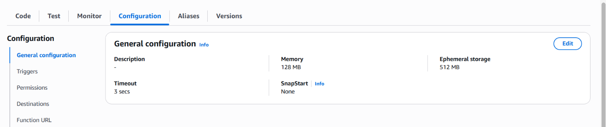

5. **Increase the function Timeout**
   - Under the **Configuration** tab, select **General configuration**. By default, the function has `128 MB` Memory, `512 MB` Ephemeral storage, and a `3` second Timeout.
   - A 3-second timeout is too short because the function must query DynamoDB, call the Groq API, and wait for the model to generate a response. If it times out, Lambda terminates execution and the client receives an error.
   - Select **Edit** to update:
     - **Timeout**: set to `0 min 30 sec`.
     - **Execution role**: keep `legal-ai-chat-role`.
     - **Memory**: keep `128 MB`, which is sufficient for this workshop.
   - Scroll to the bottom of the page and select **Save**.
    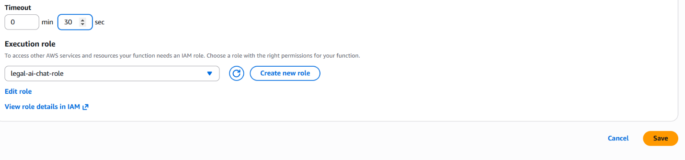

*(Processing flow inside the Lambda function)*
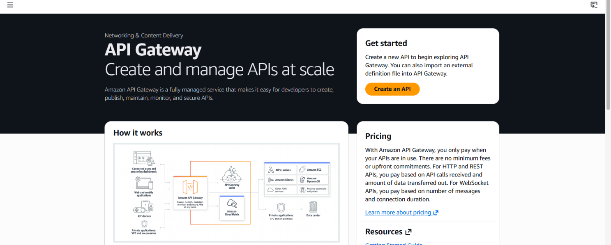

### 5.4.3 Configuring API Gateway & Standardizing Error Handling

**Objective**
Expose the Lambda function through a public HTTPS endpoint that browsers are allowed to call.

**Steps**

1. Create an API (HTTP or REST) with a `POST` route pointing to the Lambda function.
2. Configure CORS: `Access-Control-Allow-Origin: *`, with `POST` and `OPTIONS` methods.
3. Build an error-handling layer in Lambda returning the codes in the table below.
4. Deploy the stage and record the API invocation URL.

| Code | When | Meaning for Client |
| --- | --- | --- |
| `400` | Invalid request data | Fix the request |
| `429` | Groq API rate limit reached | Wait and retry |
| `502` / `504` | System or AI error | Retry later |

#### Configuring API Gateway for the Lambda Function

**Create an HTTP API**
1. In the AWS Management Console, type `API Gateway` in the search bar and press **Enter**. API Gateway is a fully managed service for creating, publishing, monitoring, and securing APIs at any scale; here it acts as the public HTTPS gateway for the S3 website to call the Lambda function. Select **Create an API** in the **Get started** box.
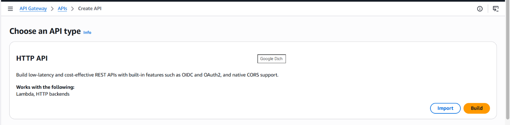

2. On the **Choose an API type** page, find the **HTTP API** card and select **Build**. 
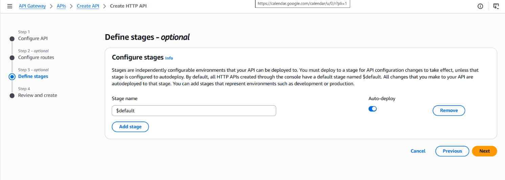
HTTP APIs offer low latency, low cost, built-in CORS support, and integration with Lambda or HTTP backends—sufficient and cheaper than REST APIs for this workshop.

**Step 1: Configure API**
- Under **API details**:
  - **API name**: name it `LegalChatAPI`.
  - **IP address type**: keep `IPv4`.
  - **Integrations**: select **Add integration** to choose the backend service the API will call.
- Under **Integrations**:
  - Choose the **Lambda** integration type.
  - **AWS Region**: select the Lambda function's region.
  - **Lambda function**: select `legal-ai-chat-lambda`.
  - **Version**: keep `2.0` (HTTP API payload format version 2.0).
  - Select **Next**.
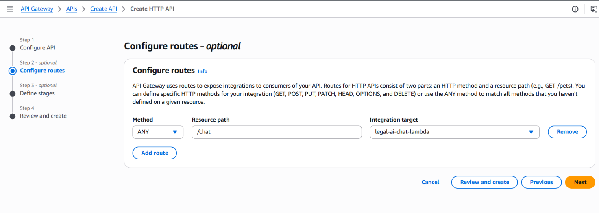 
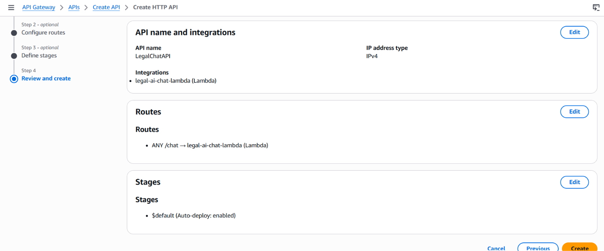

**Step 2: Configure routes**
- A route consists of two parts: **Method** (HTTP method) and **Resource path**.
- **Method**: `POST`
- **Resource path**: enter `/chat`.
- **Integration target**: select `legal-ai-chat-lambda`.
- Select **Next**.
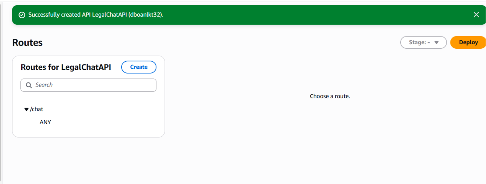

**Step 3: Define stages**
- A **Stage** is a deployment environment for the API (for example `dev`, `prod`). By default, the console creates the `$default` stage.
- **Auto-deploy**: enabled, meaning changes are automatically deployed to this stage.
- Keep defaults and select **Next**.

**Step 4: Review and create**
- Review the full configuration:
  - **API name**: `LegalChatAPI`, `IPv4`.
  - **Integrations**: `legal-ai-chat-lambda` (Lambda).
  - **Routes**: `ANY /chat` → `legal-ai-chat-lambda`.
  - **Stages**: `$default` (Auto-deploy: enabled).
- Select **Create**. Once created, `Successfully created API LegalChatAPI` appears.
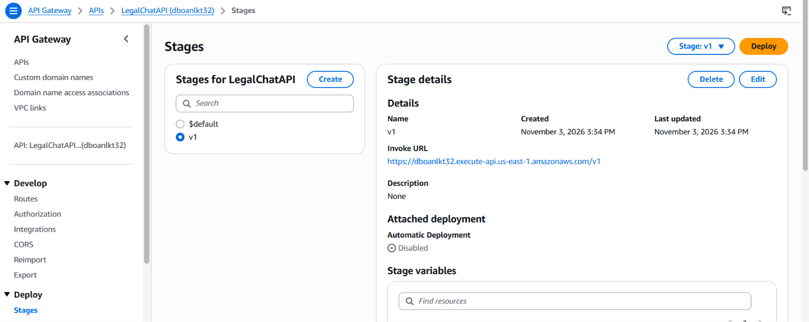

**Configure CORS**
CORS allows a website on one domain (the S3 website) to call an API on another domain (API Gateway). Without it, browsers block the request.
1. In the left menu under **Develop**, select **CORS**. Currently all fields show `No Origins/Headers/Methods are allowed` → select **Configure**.
2. Enter the values:
   - **Access-Control-Allow-Origin**: enter `*` and select **Add** (allows any origin).
   - **Access-Control-Allow-Headers**: enter `content-type` and select **Add**.
   - **Access-Control-Allow-Methods**: select `POST` and `OPTIONS`.
   - **Access-Control-Max-Age**: set to `0`. **Allow-Credentials**: set to `NO`.
   - Select **Save**.
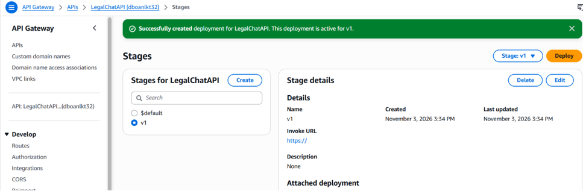

**Create stage and deploy**
1. Create stage `v1`. **Stage details** displays the **Invoke URL** in the format `https://<api-id>.execute-api.<region>[.amazonaws.com/v1](https://.amazonaws.com/v1)`. This is the base URL to call the API. **Automatic Deployment** for stage `v1` is `Disabled`, so you must click **Deploy** manually whenever configuration changes.
2. Select **Deploy** and choose stage `v1`. The message `Successfully created deployment for LegalChatAPI. This deployment is active for v1` confirms deployment.
3. The full URL to invoke the function is Invoke URL + route:
   `https://<api-id>.execute-api.<region>[.amazonaws.com/v1/chat](https://.amazonaws.com/v1/chat)`

### 5.4.4 Testing the Backend

**Objective**
Prove the backend works before connecting the frontend.

**Steps**

1. Send a `POST` request using `curl` with a sample question.
2. Open **CloudWatch Logs** and inspect response time, returned data, and JSON structure.
3. Test error cases: empty question (`400`) and, if possible, rate-limit exceeded (`429`).

```bash
curl -X POST "<API_URL>" \
  -H "Content-Type: application/json" \
  -d '{"question": "Dùng CCCD để trao đổi mua bán có được không.?"}'
```

**Verification**
`curl` returns a grounded answer and logs show the complete execution flow.


