### Tổng quan

| Mục | Nội dung |
| --- | --- |
| **Mục đích** | Backend serverless truy xuất điều luật, gọi LLM và cung cấp API ổn định. |
| **Dịch vụ AWS** | DynamoDB, Lambda, API Gateway, CloudWatch |
| **Đầu vào** | HTTP POST chứa câu hỏi của người dùng |
| **Đầu ra** | JSON chuẩn chứa câu trả lời hoặc mã lỗi |
| **Phụ thuộc** | Prompt ở Giai đoạn 1; Groq API key |

### 5.4.1 Xây dựng Knowledge Base trên DynamoDB

**Mục tiêu**
Lưu các điều luật vào bảng mà Lambda truy vấn được.

**Các bước**

1. **Tạo bảng DynamoDB `LegalArticles`**
   - Trong AWS Management Console, gõ `DynamoDB` vào ô tìm kiếm và nhấn **Enter**.
   - Ở menu bên trái chọn **Tables**, sau đó chọn **Create table**.
    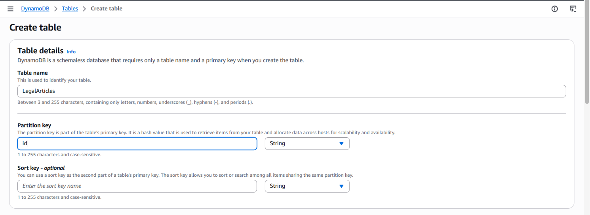

   - Trong phần **Table details**:
     - **Table name**: đặt tên bảng là `LegalArticles`. Tên dài 3–255 ký tự, chỉ gồm chữ, số, dấu gạch dưới (`_`), gạch ngang (`-`) và dấu chấm (`.`).
     - **Partition key**: nhập `id`, kiểu `String`. Là khóa chính dùng để định danh từng điều luật. DynamoDB băm giá trị này để biết lưu và tìm item ở đâu.
     - **Sort key** (tùy chọn): để trống vì bảng chỉ cần một khóa là `id`.
   - Cài đặt mặc định và chọn **Create table**. Sau vài giây, bảng `LegalArticles` chuyển sang trạng thái **Active**. 
   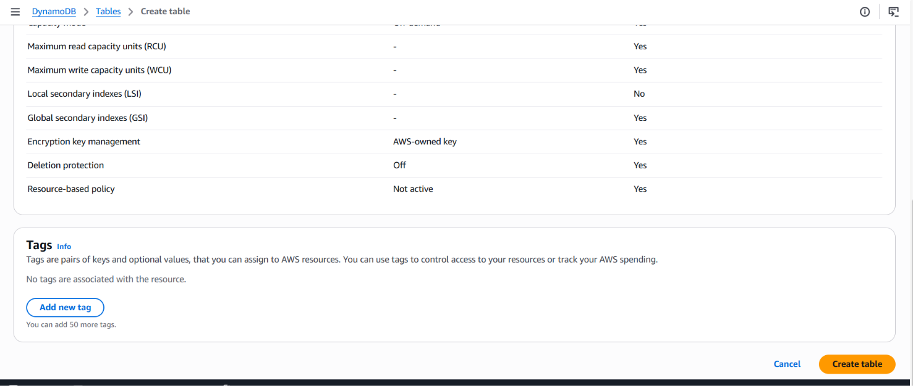
   Các bước sau sẽ thêm các điều luật của Nghị định 13/2023/NĐ-CP vào bảng này.

2. **Chuẩn bị IAM Role cho Lambda**
   - Trong AWS Management Console, gõ `IAM` vào ô tìm kiếm và nhấn **Enter**.
   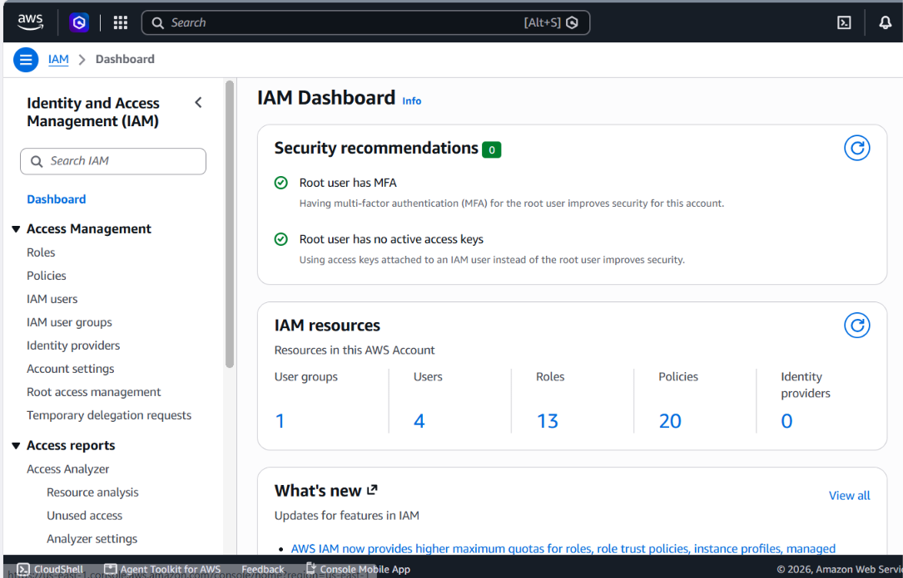

   - Trang **IAM Dashboard**:
     - Mục **Security recommendations** cho thấy tài khoản đã đạt hai khuyến nghị bảo mật: root user đã bật MFA và root user không có access key đang hoạt động. Đây là cách làm đúng theo nguyên tắc: bật MFA cho root và làm việc bằng IAM user.
     - Mục **IAM resources** thống kê tài nguyên hiện có: 1 user group, 4 users, 13 roles, 20 policies và 0 identity providers.
     - Menu bên trái gồm **Roles**, **Policies**, **IAM users**... Chúng ta sẽ dùng **Roles** để tạo role cho Lambda.
   - Ở menu bên trái, chọn **Roles**.
   - Trang danh sách **Roles** hiển thị danh sách Roles (13) của tài khoản. Role là một danh tính có các quyền cụ thể và dùng thông tin xác thực ngắn hạn, có thể được các thực thể tin cậy (như Lambda) đảm nhận (assume).
   - Chọn **Create role** ở góc phải để tạo role mới.
    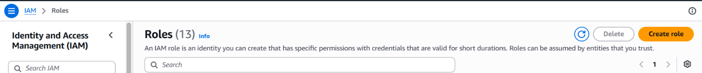

   - Khi tạo role, thiết lập như sau:
     - **Trusted entity type**: chọn `AWS service`, **Use case**: chọn `Lambda`.
     - **Permissions**: gắn managed policy `AWSLambdaBasicExecutionRole` để Lambda ghi được log vào CloudWatch, và thêm policy cho phép đọc bảng `LegalArticles` (chỉ cấp quyền tối thiểu cần thiết).
     - **Role name**: đặt tên gợi nhớ, ví dụ `legal-ai-chat-role`.
   - Chọn **Create role**.
   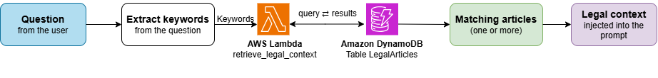

*(Retrieving articles from DynamoDB – `retrieve_legal_context`)*
    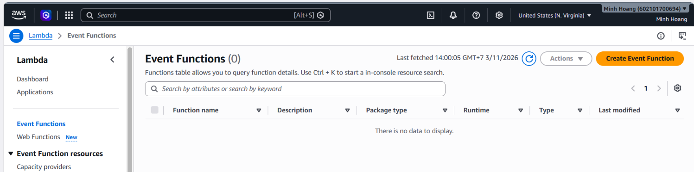

### 5.4.2 Lập trình hàm AWS Lambda (logic RAG & Groq API)

**Mục tiêu**
Truy xuất ngữ cảnh luật và sinh câu trả lời trong một hàm Python.

**Các bước**

1. **Tạo hàm Lambda**
   - Trong AWS Management Console, gõ `Lambda` vào ô tìm kiếm và nhấn **Enter**.
   - Trang **Functions** hiển thị danh sách các hàm Lambda trong region hiện tại. Chọn **Create function** ở góc phải để tạo hàm mới.
   - Ở trang **Create function**, chọn **Author from scratch**:
    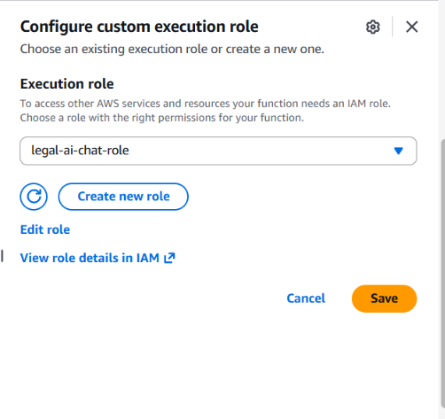
    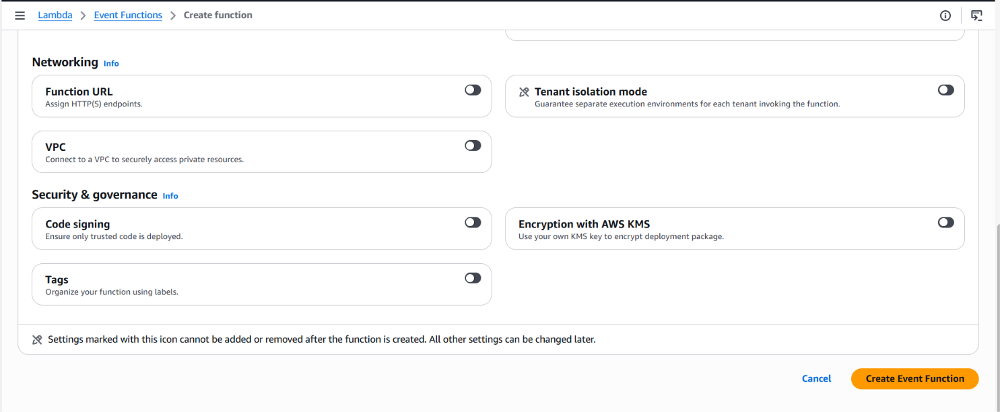 

     - **Function name**: đặt là `legal-ai-chat-lambda`. Tên dài 1–64 ký tự, không có khoảng trắng, chỉ gồm chữ, số, gạch ngang (`-`) và gạch dưới (`_`).
     - **Runtime**: chọn `Python 3.12` (ngôn ngữ để viết hàm; trình soạn thảo trên console hỗ trợ Node.js, Python và Ruby).
     - **Permissions**: mặc định Lambda tự tạo một execution role chỉ có quyền ghi log lên CloudWatch Logs. Vì hàm của chúng ta cần đọc thêm DynamoDB, ta sẽ dùng role có sẵn ở bước tiếp theo.

2. **Gắn Execution Role đã tạo**
   - Kéo xuống phần **Additional settings**, bật công tắc **Custom execution role**. Các tùy chọn khác như ARM64 architecture, Function URL, VPC, Durable execution giữ nguyên ở trạng thái tắt.
   - Khi bật **Custom execution role**, panel **Configure custom execution role** hiện ra bên phải. Mở danh sách **Execution role** để chọn role có sẵn:
     - **Execution role**: chọn `legal-ai-chat-role` (role đã tạo ở bước trước).
     - Nếu muốn kiểm tra quyền của role, chọn **View role details in IAM**.
     - Chọn **Save**.
    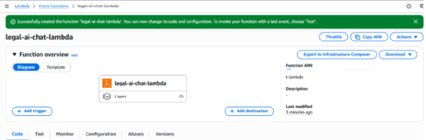
    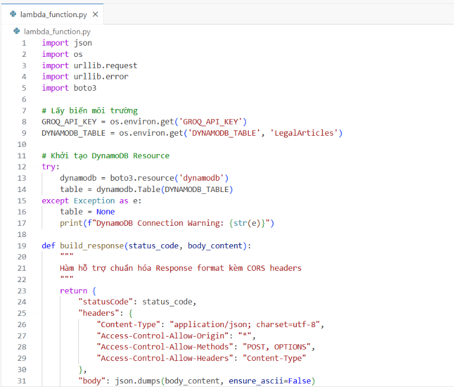

   - Kiểm tra các mục **Networking** và **Security & governance**: Function URL, VPC, Tenant isolation mode, Code signing, Encryption with AWS KMS, Tags đều để mặc định (tắt). Ta sẽ dùng API Gateway thay cho Function URL. Lưu ý: các cài đặt có biểu tượng riêng không thể thêm hoặc bỏ sau khi hàm được tạo; các cài đặt còn lại đổi được sau.
   - Chọn **Create function**. Hệ thống thông báo tạo hàm thành công.
    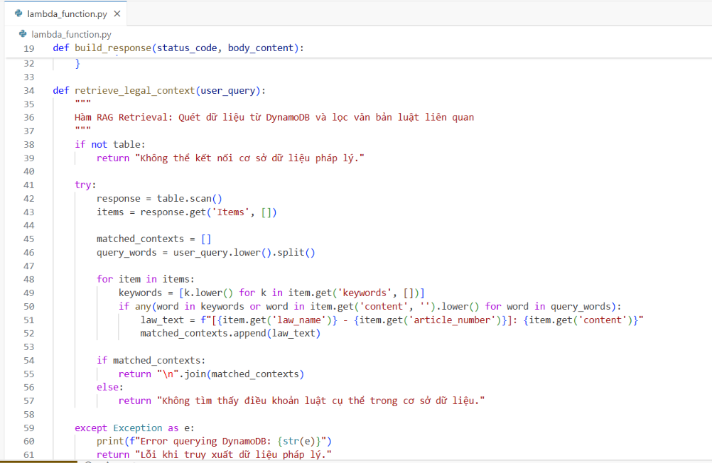

3. **Lập trình hàm Lambda (`lambda_function.py`)**
    

   - Sau khi dán code vào `lambda_function.py`, chọn **Deploy** để lưu và áp dụng code.
   - Thông báo màu xanh `Successfully updated the function “legal-ai-chat-lambda”` cho biết code đã được cập nhật. Nếu chưa bấm **Deploy**, Lambda vẫn chạy code cũ.
   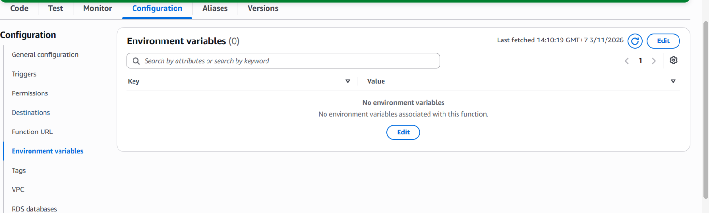
   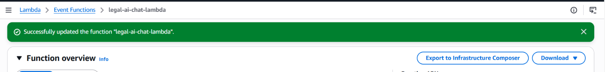

4. **Thêm biến môi trường `GROQ_API_KEY`**
   - Code đọc key từ biến môi trường `GROQ_API_KEY` nên ta không ghi key trực tiếp trong code.
   - Chọn tab **Configuration**, rồi chọn **Environment variables** ở menu bên trái.
   - Mục **Environment variables (0)** đang trống → chọn **Edit** để thêm biến mới.
   - Ở trang **Edit environment variables**, chọn **Add environment variable** và điền:
     - **Key**: `GROQ_API_KEY`
     - **Value**: dán API key `gsk_...` đã copy ở bước tạo key trên Groq.
   - Chọn **Save**. Sau khi lưu, hệ thống hiện thông báo `Successfully updated the function`. Biến `GROQ_API_KEY` đã được gắn vào hàm; nếu thiếu biến này, hàm sẽ trả lỗi `500` “Thiếu cấu hình GROQ_API_KEY trên hệ thống” như đã viết trong code.
   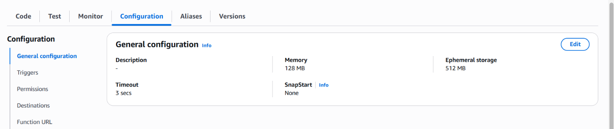

5. **Tăng Timeout của hàm**
   - Ở tab **Configuration**, chọn **General configuration**. Mặc định hàm có Memory `128 MB`, Ephemeral storage `512 MB` và Timeout chỉ `3 giây`.
   - Thời gian chờ 3 giây quá ngắn, vì hàm phải quét DynamoDB rồi gọi Groq API và chờ mô hình sinh câu trả lời. Nếu quá thời gian, Lambda sẽ tự ngắt và client nhận lỗi.
   - Chọn **Edit** để chỉnh:
     - **Timeout**: đặt `0 min 30 sec`.
     - **Execution role**: giữ nguyên `legal-ai-chat-role`.
     - **Memory**: giữ `128 MB` là đủ cho bài này.
   - Kéo xuống cuối trang và chọn **Save**.
   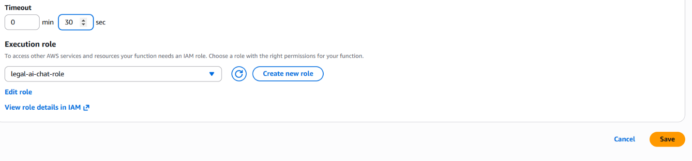

*(Processing flow inside the Lambda function)*
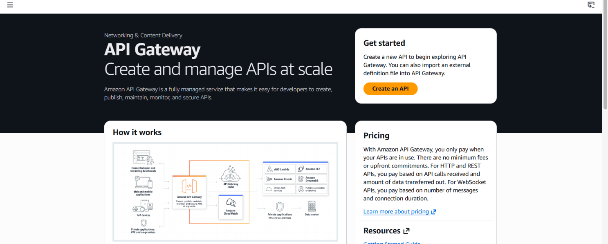

### 5.4.3 Cấu hình API Gateway & chuẩn hóa Error Handling

**Mục tiêu**
Mở hàm Lambda qua endpoint HTTPS công khai mà trình duyệt được phép gọi.

**Các bước**

1. Tạo API (HTTP hoặc REST) với route `POST` trỏ tới hàm Lambda.
2. Cấu hình CORS: `Access-Control-Allow-Origin: *`, các method `POST` và `OPTIONS`.
3. Xây tầng bắt lỗi trong Lambda trả về các mã trong bảng bên dưới.
4. Deploy stage và ghi lại URL gọi API.

| Mã | Khi nào | Ý nghĩa với client |
| --- | --- | --- |
| `400` | Dữ liệu không hợp lệ | Sửa lại request |
| `429` | Chạm giới hạn của Groq API | Chờ rồi thử lại |
| `502` / `504` | Lỗi hệ thống hoặc AI | Thử lại sau |

#### Cấu hình API Gateway cho hàm Lambda

**Tạo HTTP API**
1. Trong AWS Management Console, gõ `API Gateway` vào ô tìm kiếm và nhấn **Enter**. API Gateway là dịch vụ được quản lý hoàn toàn, giúp tạo, xuất bản, giám sát và bảo mật API ở mọi quy mô; trong bài này nó đóng vai trò cổng HTTPS công khai để trang web S3 gọi tới hàm Lambda. Chọn **Create an API** ở khung **Get started**.
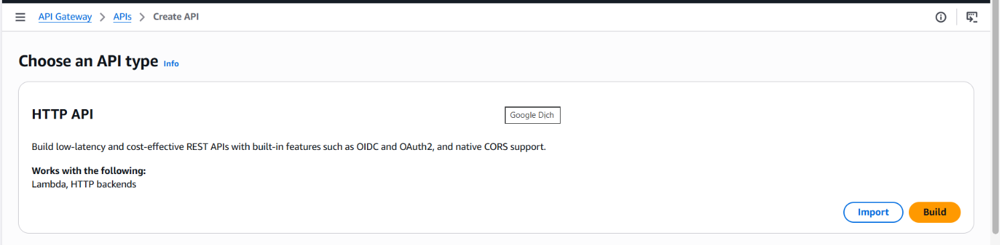

2. Ở trang **Choose an API type**, tìm thẻ **HTTP API** và chọn **Build**. 
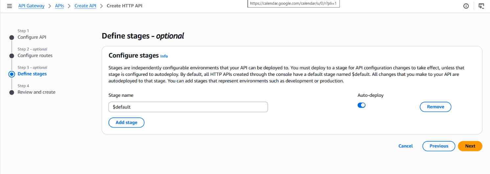

HTTP API có độ trễ thấp, chi phí thấp, hỗ trợ sẵn CORS, và tích hợp được với Lambda hoặc HTTP backend — đủ dùng và rẻ hơn REST API.

**Bước 1: Configure API**
- Trong phần **API details**:
  - **API name**: đặt là `LegalChatAPI`.
  - **IP address type**: giữ `IPv4`.
  - **Integrations**: chọn **Add integration** để chọn dịch vụ backend mà API sẽ gọi tới.
- Trong phần **Integrations**:
  - Chọn loại tích hợp **Lambda**.
  - **AWS Region**: chọn region của hàm Lambda.
  - **Lambda function**: chọn hàm `legal-ai-chat-lambda`.
  - **Version**: giữ `2.0` (payload format version 2.0 của HTTP API).
  - Chọn **Next**.
  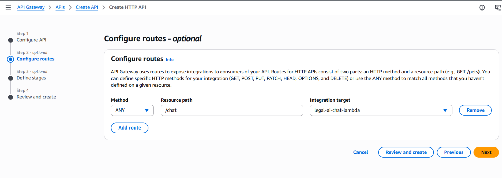 
  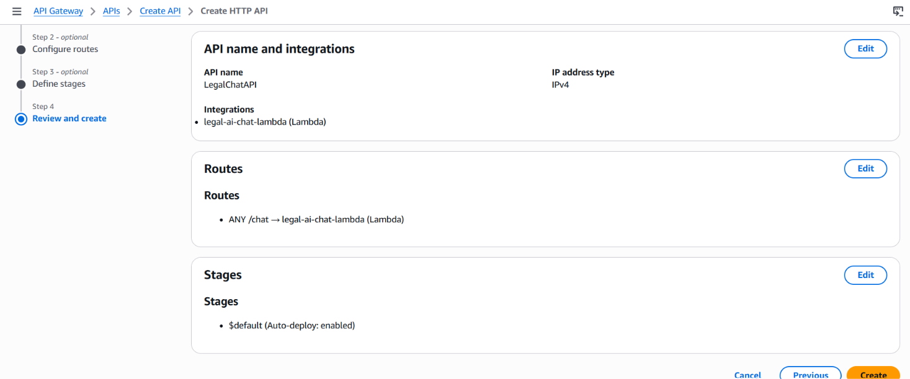

**Bước 2: Configure routes**
- Route gồm hai phần: **Method** (phương thức HTTP) và **Resource path** (đường dẫn).
- **Method**: `POST`
- **Resource path**: nhập `/chat`.
- **Integration target**: chọn `legal-ai-chat-lambda`.
- Chọn **Next**.
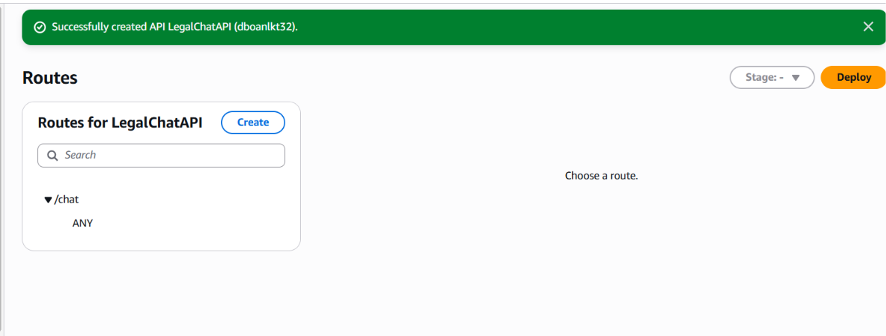

**Bước 3: Define stages**
- **Stage** là môi trường triển khai của API (ví dụ `dev`, `prod`). Mặc định console tạo stage `$default`.
- **Auto-deploy**: đang bật, nghĩa là mọi thay đổi sẽ tự được triển khai lên stage này.
- Giữ mặc định và chọn **Next**.


**Bước 4: Review and create**
- Kiểm tra lại toàn bộ cấu hình:
  - **API name**: `LegalChatAPI`, `IPv4`.
  - **Integrations**: `legal-ai-chat-lambda` (Lambda).
  - **Routes**: `ANY /chat` → `legal-ai-chat-lambda`.
  - **Stages**: `$default` (Auto-deploy: enabled).
- Chọn **Create**. Khi tạo xong, hiện thông báo `Successfully created API LegalChatAPI`.
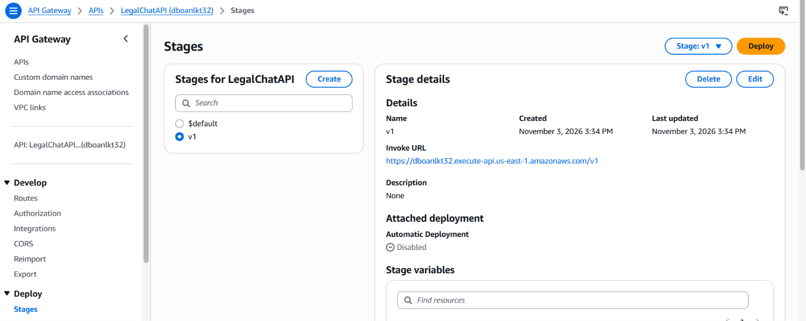

**Cấu hình CORS**
CORS cho phép trang web ở một domain (website S3) gọi API ở domain khác (API Gateway). Nếu thiếu, trình duyệt sẽ chặn request.
1. Ở menu bên trái, mục **Develop**, chọn **CORS**. Hiện tại các mục đều ghi `No Origins/Headers/Methods are allowed` → chọn **Configure**.
2. Điền các giá trị:
   - **Access-Control-Allow-Origin**: nhập `*` rồi chọn **Add** (cho phép mọi origin).
   - **Access-Control-Allow-Headers**: nhập `content-type` rồi chọn **Add**.
   - **Access-Control-Allow-Methods**: chọn `POST` và `OPTIONS`.
   - **Access-Control-Max-Age**: để `0`. **Allow-Credentials**: để `NO`.
   - Chọn **Save**.
   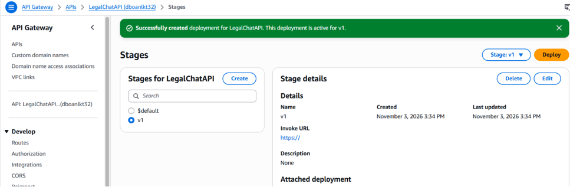

**Tạo stage và deploy**
1. Tạo stage `v1`. Phần **Stage details** hiển thị **Invoke URL** có dạng `https://<api-id>.execute-api.<region>[.amazonaws.com/v1](https://.amazonaws.com/v1)`. Đây là địa chỉ gốc để gọi API. **Automatic Deployment** của stage `v1` đang `Disabled`, nên mỗi lần sửa cấu hình phải bấm **Deploy** thủ công.
2. Chọn **Deploy** và chọn stage `v1`. Thông báo `Successfully created deployment for LegalChatAPI. This deployment is active for v1` cho biết API đã được triển khai.
3. URL đầy đủ để gọi hàm là Invoke URL + route:
   `https://<api-id>.execute-api.<region>[.amazonaws.com/v1/chat](https://.amazonaws.com/v1/chat)`

### 5.4.4 Kiểm thử Backend

**Mục tiêu**
Chứng minh backend hoạt động trước khi nối giao diện.

**Các bước**

1. Gửi POST bằng `curl` với một câu hỏi mẫu.
2. Mở **CloudWatch Logs** và kiểm tra thời gian phản hồi, dữ liệu trả về và cấu trúc JSON.
3. Test các trường hợp lỗi: câu hỏi rỗng (`400`) và, nếu có thể, trường hợp quá giới hạn (`429`).

```bash
curl -X POST "<API_URL>" \
  -H "Content-Type: application/json" \
  -d '{"question": "Dùng CCCD để trao đổi mua bán có được không.?"}'
```

**Kiểm tra**
`curl` trả về câu trả lời có căn cứ và log thể hiện đủ luồng xử lý.

