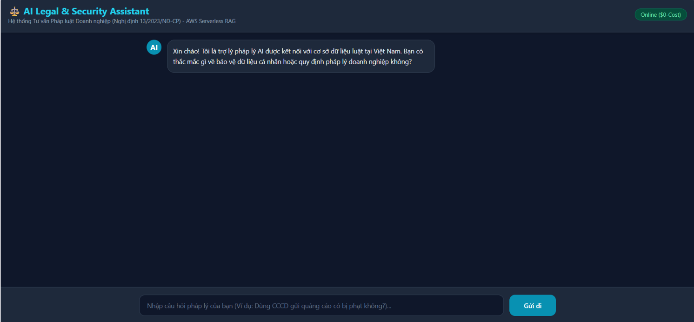
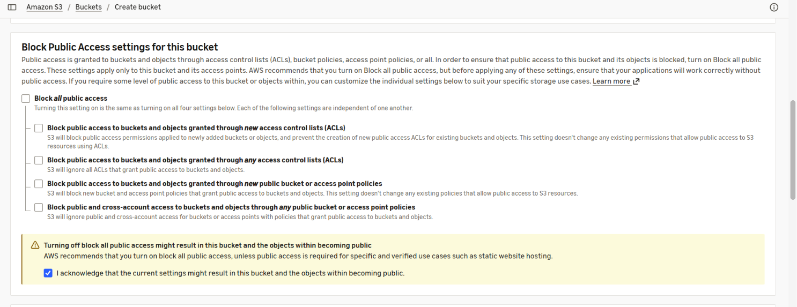
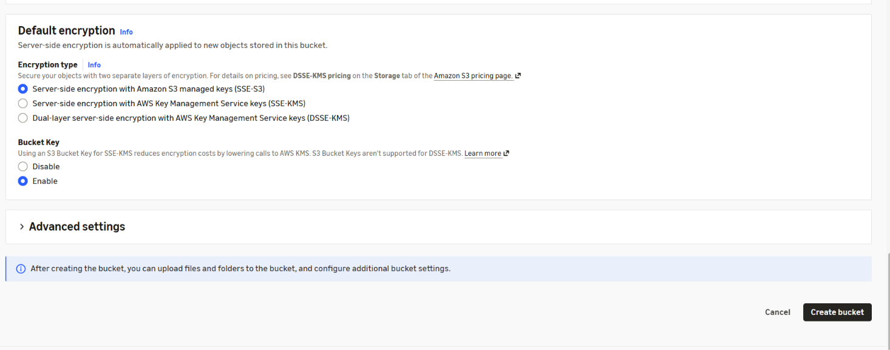
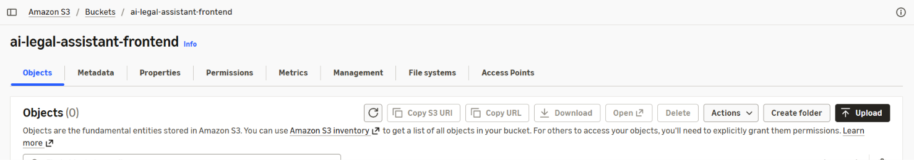
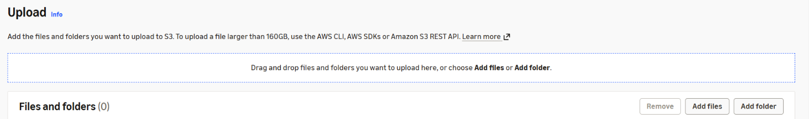
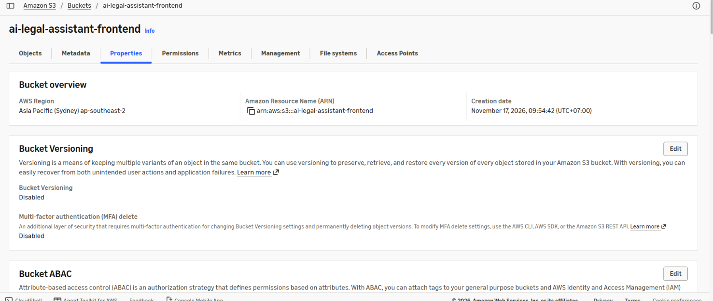
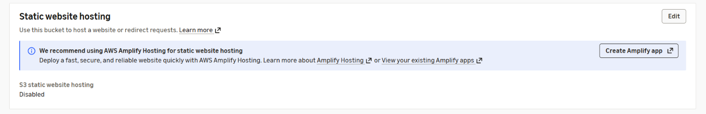
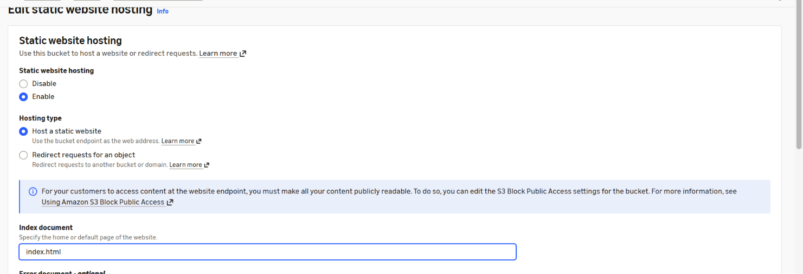

### Overview

| Item | Details |
| --- | --- |
| **Purpose** | Chat page for users to ask questions and read answers. |
| **AWS Services** | Amazon S3 (static website hosting) |
| **Inputs** | User question |
| **Outputs** | Answer displayed in the chat box |
| **Dependencies** | Backend API URL |

### 5.5.1 Building the Chat Interface (index.html)

**Objective**
A single static page calling the backend using `fetch`.

**Steps**
1. Build the chat layout: title, status badge, greeting, message list, input box, and send button.
2. When submitted, call `fetch` via HTTP `POST` to the API URL and show a processing state.
3. Display clear messages for errors (`400`, `429`, `502`/`504`).
4. Recommendation: add a disclaimer showing that answers are preliminary, not legal advice.

**Verification**
Opening `index.html` locally displays the chat page and greeting.

### 5.5.2 Hosting the Page on S3

**Objective**
Expose `index.html` publicly as a static website.

**Steps**
1. Create the `ai-legal-assistant-frontend-hau` bucket in `ap-southeast-2`.
2. Upload `index.html`.
3. Enable **Static website hosting** with `index.html` as the index document.
4. Allow public read access specifically for this bucket (disable **Block Public Access** for it and add a read-only bucket policy).
5. Open the website endpoint.

**Console Walkthrough Details**
- **1:** Create an S3 bucket in the `ap-southeast-2` region, type **General purpose**, and enter the bucket name.

- **2:** Uncheck **Block all public access** for this bucket only and confirm the warning.

- **3:** Keep default **SSE-S3** encryption and select **Create bucket**.

- **4:** The bucket is created, and the **Objects** list is empty.

- **5:** **Upload** page to upload the `index.html` file to the bucket (upload html file).

**Enable static website hosting**
1. The bucket’s Properties tab shows the Region, ARN, and creation date.

2. The Static website hosting section is Disabled. Select Edit.

3. Enable static website hosting, select Host a static website, and set Index document to index.html.

**Verification**
The endpoint `[http://ai-legal-assistant-frontend-hau.s3-website-ap-southeast-2.amazonaws.com/](http://ai-legal-assistant-frontend-hau.s3-website-ap-southeast-2.amazonaws.com/)` loads the page.

### 5.5.3 Connecting the API and End-to-End Testing

**Objective**
Have the deployed page call the live backend.

**Steps**
1. Set the API URL in `index.html` and re-upload it.
2. Open the website and ask a sample question.
3. Open the browser console and verify there are no CORS errors.
4. Check the request in **CloudWatch Logs**.

**Console Walkthrough Details**
- **1:** **Properties** tab of the bucket, view Region, ARN, and creation date.
- **2:** **Static website hosting** is **Disabled**, select **Edit**.
- **3:** Enable **Static website hosting**, select **Host a static website**, and set **Index document** to `index.html`.

**Verification**
Question → grounded answer on the page, accompanied by a corresponding log entry.