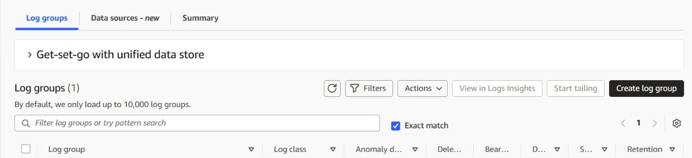
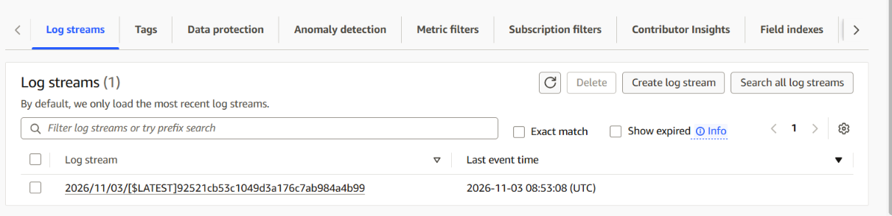
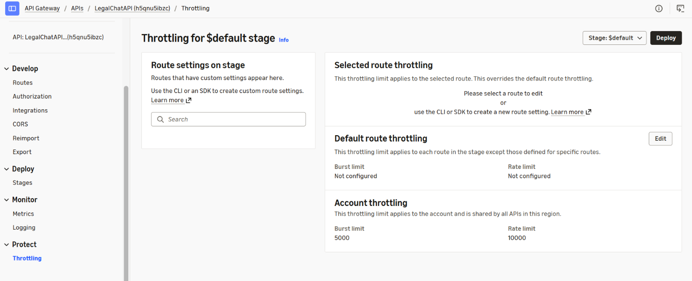
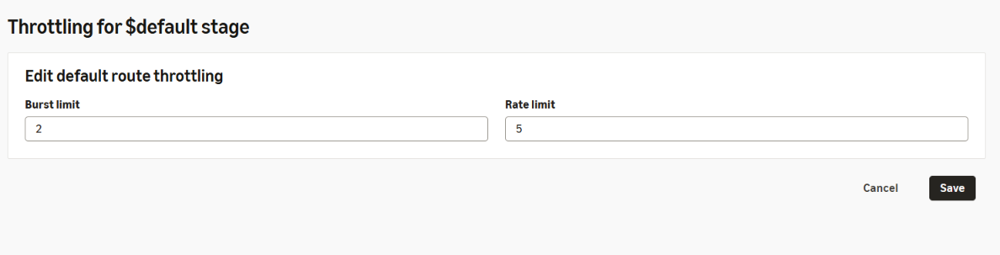

### Overview

| Item | Details |
| --- | --- |
| **Purpose** | Understand current security posture, operational and cost monitoring, and plan improvements. |
| **AWS Services** | CloudWatch, AWS Budgets, IAM |

### 5.6.1 Current Security Posture

| Area | Current State | Risk | Recommendation |
| --- | --- | --- | --- |
| **API Gateway** | Rate/burst limits configured on stage `v1` | Anyone with the URL can call it and exhaust Groq quota | Throttling + usage plan / API key; Cognito later |
| **CORS** | `Access-Control-Allow-Origin: *` | Any website can call the API from a browser | Restrict to the S3 site origin after the demo |
| **Groq API key** | Lambda environment variable | Exposed if committed or shown in screenshots | Move to SSM Parameter Store (`SecureString`); rotate key if leaked |
| **S3 website** | Public read, HTTP only | Traffic is unencrypted | Place CloudFront in front for HTTPS if needed |
| **Data sent to Groq** | Questions leave AWS | Real customer data could leave the account | Use sample questions only; review Groq data policy; consider Bedrock |
| **CloudWatch** | Lambda logging enabled | Logs may contain user questions | Set retention period (7–14 days); avoid logging sensitive data |

### 5.6.2 Monitoring and Cost Control

**Objective**
Detect errors and cost anomalies early.

**Steps**
1. Set log retention for the Lambda log group.
2. Create an alarm for Lambda errors (optional).
3. Regularly check the **Free Tier usage** page under **Billing** and keep the **Budget** alert from Section 5.2 active.

**Console Walkthrough Details**
- **1:** CloudWatch overview page, open **Logs** to view Lambda logs.

- **2:** **Log groups** list, the Lambda function's log group created automatically by Lambda.

- **3:** **Log streams** list, each stream records function requests along with the latest log timestamp.

**Verification**
Test requests appear in the logs; the Budget alert is active.

### 5.6.3 Security Hardening Roadmap

**Steps**
1. Add throttling and a usage plan to the API to protect Groq quota (high priority, no frontend changes required).
2. Move the Groq key to SSM Parameter Store and grant Lambda permission to read only that specific parameter.
3. Restrict CORS to the website's origin.
4. Add Cognito sign-in if the system moves beyond demo mode.
5. Testing: call the API at high rate to confirm throttling; test prompt injection questions; scan the repository for secrets.

**Configuring Throttling on API Gateway**
- **1:** Stage **Throttling** page, showing currently applied limits:
  - **Stage**: select the stage to limit in the top-right corner (screenshot shows `$default`). Each stage has its own throttling configuration.
  - **Selected route throttling**: per-route limits (overrides default). Currently empty because no route is selected.
  - **Default route throttling**: limits applied to all routes in the stage. Currently **Burst limit** and **Rate limit** both show `Not configured`, meaning no limit is set.
  - **Account throttling**: account-wide ceiling in the region (Burst `5000`, Rate `10000`), shared across all APIs. This is a system-level limit and is not edited here.

  - Select **Edit** under **Default route throttling**.
- **2:** Set **Burst limit = 2** and **Rate limit = 5** for the default route:
  - **Rate limit**: `5`, maximum average requests per second.
  - **Burst limit**: `2`, maximum concurrent requests handled during a burst.
  - Select **Save**, then select **Deploy** to apply.

Requests exceeding the limit receive `429 Too Many Requests` from API Gateway before reaching Lambda and Groq.