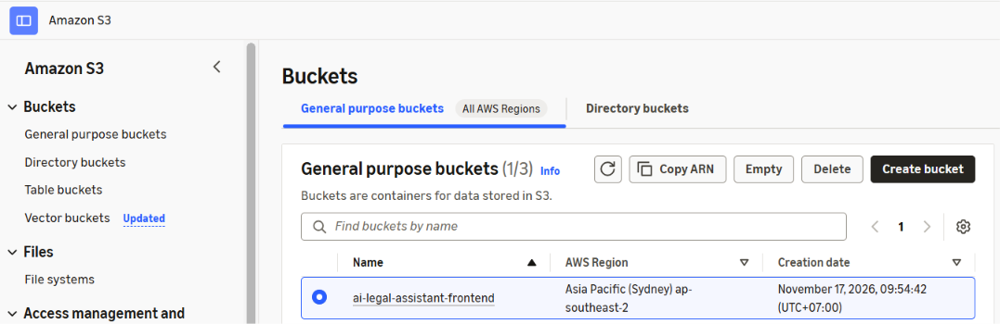
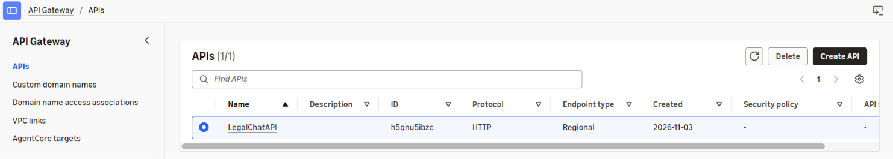
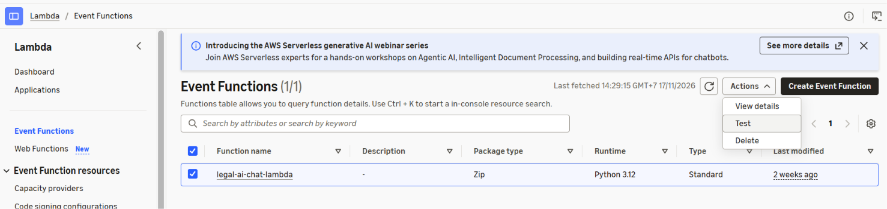
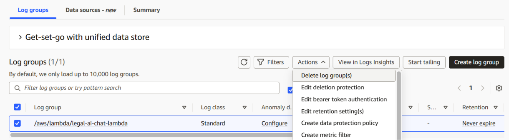
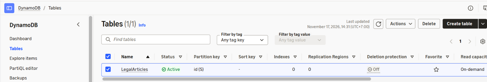
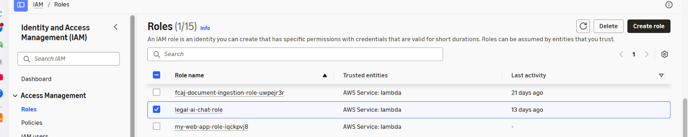
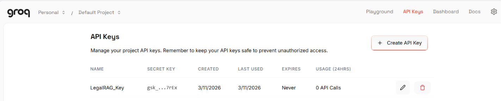

### Resource Cleanup Order

Delete resources in the following order to avoid dependency errors and unexpected charges:

1. S3 bucket (`ai-legal-assistant-frontend-hau`)

2. API in API Gateway (`LegalChatAPI`)

3. Lambda function (`legal-ai-chat-lambda`) and its CloudWatch log group

4. DynamoDB table `LegalArticles`

5. IAM role created for Lambda (`legal-ai-chat-role`)

6. Revoke the Groq API key in Groq Console 
