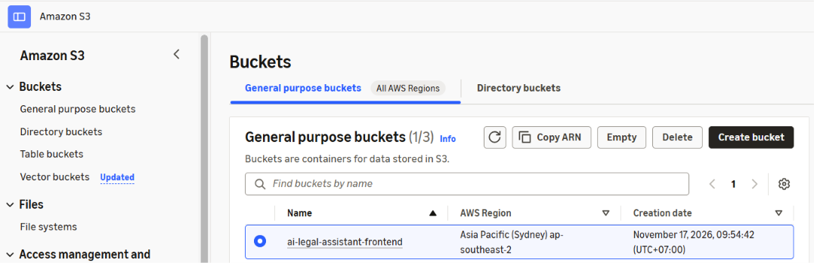
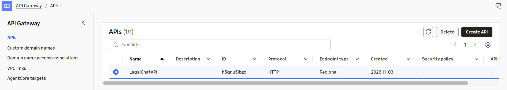
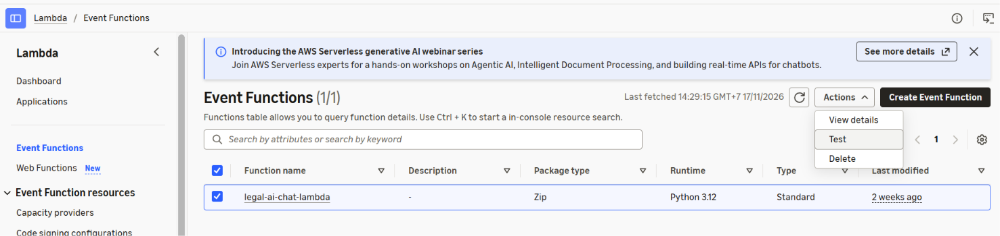
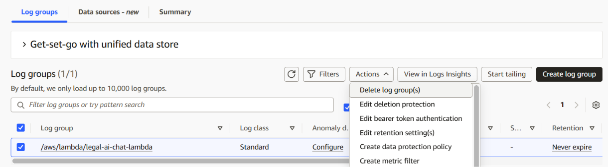
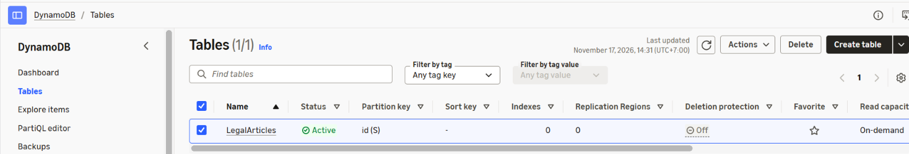
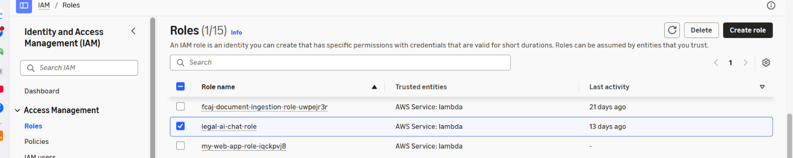
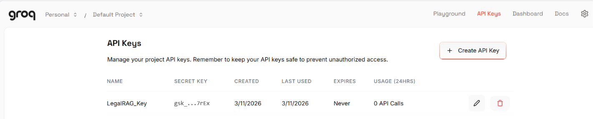

### Thứ tự dọn dẹp tài nguyên

Xóa tài nguyên theo thứ tự sau để tránh lỗi phụ thuộc và chi phí phát sinh:

1. S3 bucket (`ai-legal-assistant-frontend-hau`)

2. API trong API Gateway (`LegalChatAPI`)

3. Hàm Lambda (`legal-ai-chat-lambda`) và log group CloudWatch của nó

4. Bảng DynamoDB `LegalArticles`

5. IAM role tạo cho Lambda (`legal-ai-chat-role`) 

6. Thu hồi Groq API key trong Groq Console
