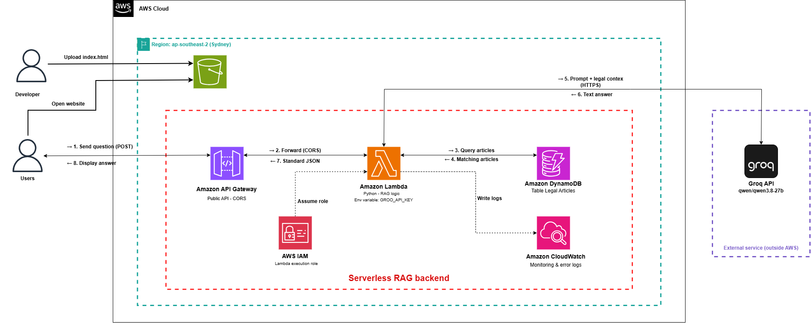

### Overview

**AI Legal & Security Assistant** is a preliminary legal advisory assistant for enterprises, focusing on Decree 13/2023/ND-CP (personal data protection). Users enter a question or a real-world scenario; the system retrieves relevant legal articles from the database, and then a large language model analyzes the question based strictly on those articles.

The system is not a lawyer and does not provide official legal conclusions. If the database lacks legal basis, the system must clearly state so.

The system is built on a serverless architecture with the following components:
- **Frontend** – static website (`index.html`) hosted on Amazon S3 (static website hosting)
- **API Gateway** – Amazon API Gateway (CORS and error standardization)
- **Backend** – AWS Lambda (Python): retrieves legal articles and calls the LLM
- **Knowledge Base** – Amazon DynamoDB (`LegalArticles` table)
- **LLM** – Groq API (`qwen/qwen3.8-27b`), an external service outside AWS
- **Monitoring** – Amazon CloudWatch

### Contents

1. [5.1 Introduction](#5.1-Introduction)
2. [5.2 Preparation](#5.2-Preparation)
3. [5.3 Phase 1 – Prompt Setup & RAG Mechanism](#5.3-Phase-1--prompt-setup--rag-mechanism)
4. [5.4 Phase 2 – Backend: From Database to Lambda & API](#5.4-Phase-2--backend-from-database-to-lambda--api)
5. [5.5 Frontend – S3 Static Website](#5.5-Frontend--s3-static-website)
6. [5.6 Security & Operations](#5.6-Security--operations)
7. [5.7 Final Outcomes and Future Directions](#5.7-Final-outcomes-and-future-directions)
8. [5.8 Resource Cleanup](#5.8-Resource-cleanup)