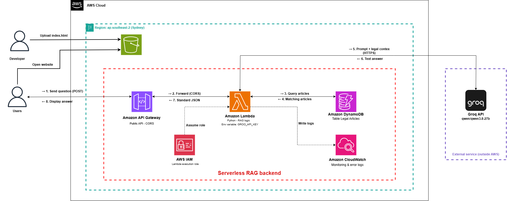

### Tổng quan

**AI Legal & Security Assistant** là trợ lý tư vấn pháp lý sơ bộ cho doanh nghiệp, tập trung vào Nghị định 13/2023/NĐ-CP (bảo vệ dữ liệu cá nhân). Người dùng nhập câu hỏi hoặc một tình huống thực tế; hệ thống tra cứu các điều luật liên quan trong cơ sở dữ liệu, sau đó mô hình ngôn ngữ lớn phân tích câu hỏi chỉ dựa trên các điều luật đó.

Hệ thống không phải luật sư và không đưa ra kết luận pháp lý chính thức. Nếu cơ sở dữ liệu thiếu căn cứ, hệ thống phải nói rõ.

Hệ thống xây dựng trên kiến trúc serverless với các thành phần:
- **Giao diện** – trang web tĩnh (`index.html`) host trên Amazon S3 (static website hosting)
- **Cổng API** – Amazon API Gateway (CORS và chuẩn hóa lỗi)
- **Backend** – AWS Lambda (Python): truy xuất điều luật và gọi LLM
- **Cơ sở tri thức** – Amazon DynamoDB (bảng `LegalArticles`)
- **LLM** – Groq API (`qwen/qwen3.8-27b`), dịch vụ bên ngoài AWS
- **Giám sát** – Amazon CloudWatch

#### Nội dung

1. [5.1 Giới thiệu](5.1-introduction/)
2. [5.2 Chuẩn bị](5.2-preparation/)
3. [5.3 Giai đoạn 1 – Thiết lập Prompt & cơ chế RAG](5.3-phase-1--prompt-setup--rag-mechanism/)
4. [5.4 Giai đoạn 2 – Backend: từ Database đến Lambda & API](5.4-phase-2--backend-from-database-to-lambda--api/)
5. [5.5 Frontend – S3 Static Website](5.5-frontend--s3-static-website/)
6. [5.6 Bảo mật & vận hành](5.6-security--operations/)
7. [5.7 Thành quả cuối cùng và hướng phát triển](5.7-final-outcomes-and-future-directions/)
8. [5.8 Dọn dẹp tài nguyên](5.8-resource-cleanup/)